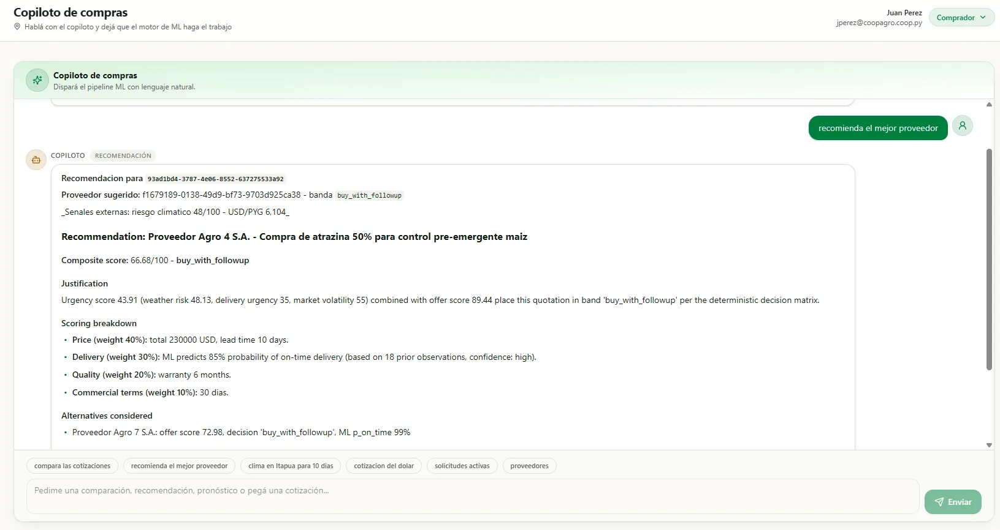
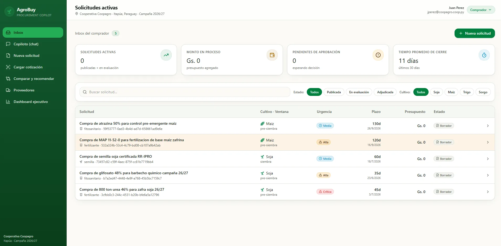
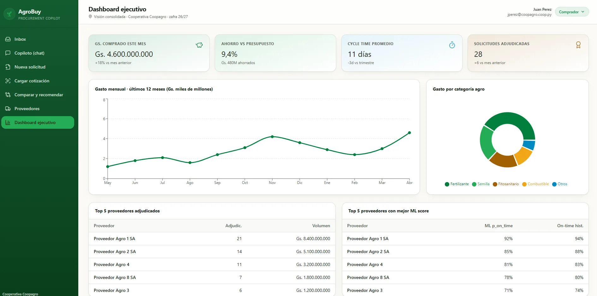
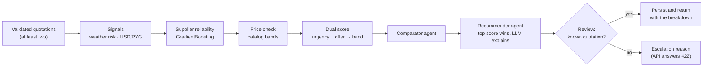
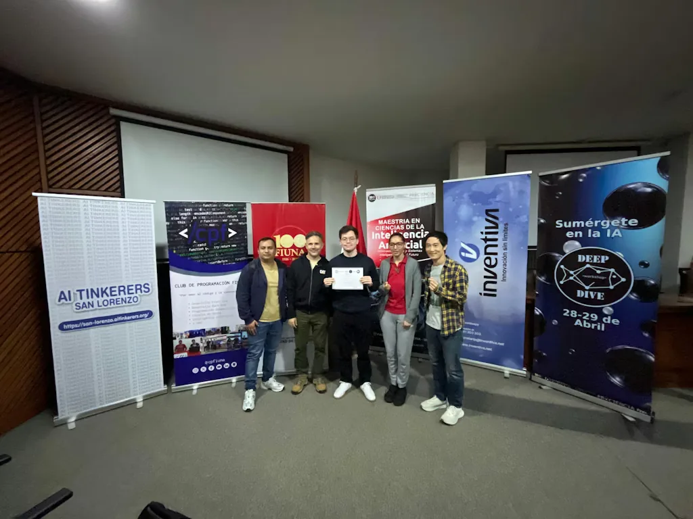

# AgroBuy


> A cooperative buying urea, seed and agrochemicals for the soybean season gets quotations in
> guaraníes or dollars, with different lead times, terms and warranties, from suppliers whose
> delivery record matters as much as the price.

AgroBuy is an AI procurement copilot for Paraguayan agricultural cooperatives. A buyer registers a
purchase request with its agronomic context, pastes supplier quotations as text, compares them at
the day's exchange rate, gets a recommended supplier with a score that shows its breakdown, and
drafts the negotiation message.

### 🏆 1st place · AI Tinkerers San Lorenzo x FIUNA Deep Dive Hackathon 2026

Built in one day by a team of five at FIUNA, San Lorenzo, Paraguay, on April 29, 2026.
[Official recap](https://san-lorenzo.aitinkerers.org/p/recap-ai-tinkerers-x-fiuna-deep-dive-hackathon-2026) ·
[FIUNA news](https://www.ing.una.py/FIUNA3/?p=85823) ·
[Event site](https://deepdivefiuna.com/) ·
[FIUNA on Instagram](https://www.instagram.com/p/DYFPVYyDqu9/)

> **My part, Franco Cazal:** the procurement backend on top of the AgroPredict AI platform: the
> four LLM agents and their orchestrator, the supplier-reliability model, the price check, the
> dual score and the live weather and exchange-rate signals. The rest of the team is listed under
> [Team](#team).

## What the demo shows

The seed loads a fictional cooperative, Cooperativa Coopagro (Itapúa, 2026/27 season), eight
fictional suppliers, five purchase requests and fifteen quotations.

1. **Inbox.** The buyer sees the open purchase requests with crop, planting window, urgency and
   deadline, and opens a new one with its agronomic context.
2. **Load a quotation.** The buyer pastes a supplier's quotation. The extractor agent returns a
   structured preview (supplier, items, total, currency, lead time, terms) that the buyer edits
   and confirms before the quotation exists. A quality gate quarantines quotations with an
   expired validity, an unsupported currency, a missing supplier or an implausible lead time.
3. **Compare.** The validated quotations side by side, with price anomalies flagged.
4. **Recommend.** The pipeline scores every validated quotation and returns the supplier, its
   decision band and the urgency, offer and composite scores. The LLM writes the justification
   around those numbers.
5. **Negotiate.** The negotiator agent drafts the email to the supplier, in Spanish.

With no LLM key, which is the Docker Compose default, every step still answers: each agent falls
back to code (regexes for the extractor, a template for the negotiator).

## Screens



*Recommend, in the copilot chat: the supplier, the band, the composite score and where each part
of it comes from, with the day's weather risk and USD/PYG rate. The weights under "Scoring
breakdown" are the buyer's stated priorities for the request; the score itself comes from the
fixed formulas under [How a recommendation is made](#how-a-recommendation-is-made) (see
[Known gaps](#known-gaps)).*



*Inbox: the five seeded purchase requests. They are drafts, so the in-process counters read
zero.*



*Executive dashboard. A static mock-up: its counters, charts and rankings are sample figures
written into [`dashboard.tsx`](frontend/src/routes/dashboard.tsx), there to show where the
product goes.*

## How a recommendation is made



- **Four LLM agents:** extractor, comparator, recommender and negotiator
  ([`procurement/agents/`](backend/agropredict/procurement/agents)), called in sequence by a plain
  Python orchestrator ([`orchestrator.py`](backend/agropredict/procurement/orchestrator.py)). Each
  agent prompts, pulls the JSON out of the answer and validates it with Pydantic; on any failure
  (LLM off, call error, malformed JSON, failed validation) it answers from code.
- **The score picks the supplier and the LLM explains it.** The recommender takes the quotation
  with the highest urgency plus offer outside `not_recommended`, then asks the LLM to justify
  those numbers. A recommendation that names an unknown quotation is escalated and never reaches
  the buyer.
- **Dual score.** Urgency = 0.45 weather risk + 0.40 delivery urgency + 0.15 market volatility.
  Offer = 0.35 supplier reliability + 0.40 commercial terms + 0.25 (100 − delivery risk)
  ([`scoring/`](backend/agropredict/procurement/scoring)). A
  [decision matrix](backend/agropredict/procurement/scoring/decision_matrix.py) maps the pair to
  five bands, from `buy_now` to `not_recommended`. Every recommendation returns the breakdown, so
  a buyer can disagree with it.
- **Supplier reliability model.** A `GradientBoostingClassifier` predicts on-time delivery. It
  scores AUC 0.748 on a stratified 20% held-out split of a **synthetic** delivery history
  ([`ml/train.py`](backend/agropredict/procurement/ml/train.py)): the demo has no real supplier
  records, so the history is generated per supplier profile. The number shows the pipeline works
  end to end; it says nothing about real suppliers. It was measured on the event day: the history
  is dated from the current date, so a rerun on another day lands slightly off it. Without the
  model file, a rules blend of the same on-time rates takes over.
- **Price anomaly check.** Each quoted unit price, in USD, is placed against the market band the
  catalog stores for its category; the further outside the band, the higher the score
  ([`ml/anomaly_detector.py`](backend/agropredict/procurement/ml/anomaly_detector.py)).
- **Live signals.** Climate risk per Paraguayan department from a 10-day Open-Meteo forecast
  (cached 6 hours, neutral 40 if the fetch fails) and the USD/PYG rate from open.er-api.com
  (cached 1 hour, configurable fixed rate as fallback)
  ([`external/`](backend/agropredict/procurement/external)).
- **API first.** FastAPI under `/api/v1/procurement`. The React app in `frontend/` consumes it.

## Scope: the full design and what the hackathon shipped

AgroBuy was designed past the event, and the build was cut down to what one day could deliver
and demo. The scope documents ([`docs/scope/`](docs/scope), in Spanish) keep the two apart; this
is that split, checked against the code.

| Area | Full design | Shipped at the hackathon |
|---|---|---|
| Orchestration | A LangGraph `ProcurementGraph` reusing the platform's checkpointing ([development plan](docs/product/DEV_PLAN.md), phase 5) | The same pipeline as nine plain Python steps behind the same API. The [docstring](backend/agropredict/procurement/orchestrator.py) gives the reason (short, synchronous, no checkpointing needed for the demo); the platform's LangGraph `PredictionGraph` ([`predictions/graph.py`](backend/agropredict/predictions/graph.py)) is the pattern to swap in |
| Price anomalies | A z-score against peer quotations and award history | The range check against catalog bands; the z-score waits for award history |
| Supplier reliability | Trained on the cooperative's own deliveries | Trained on a synthetic history |
| Quotation intake | Uploads of PDFs, spreadsheets and photos read by a vision model ([product plan](docs/product/COMPRAS_AGRO_plan.md)) | Pasted text; the upload tab asks for text until file parsing exists |
| Buyer clients | A React app and an Oracle APEX app over the same API | The React app, and the APEX [build guide](docs/development/apex) |
| Tenancy | Tenant taken from the authenticated principal | One demo tenant passed as a query parameter |
| Platform | AgroPredict AI's prediction agents, operator console and self-hosted deployment | In the repo and unused by the procurement flow; the deployment pieces are in `archive/` |

## Repository

| Path | What it is |
|---|---|
| `backend/agropredict/procurement/` | The hackathon module: agents, orchestrator, ML, scoring, external signals, demo fixtures |
| `backend/agropredict/` (the rest) | AgroPredict AI, the multi-agent platform AgroBuy is built on |
| `backend/tests/` | Backend tests |
| `frontend/` | Buyer-facing app: React 19, Vite, TanStack Router and Query, Tailwind |
| `docs/` | Hackathon notes, product plan, MVP vs full scope, APEX guide, frontend brief, pitch deck (mostly in Spanish) |
| `archive/` | Platform pieces the hackathon did not use: Helm, Kubernetes, specs, runbooks |

## Run it

```bash
cp .env.example .env              # dev secrets for compose; LLM stays off unless you add a key
docker compose up -d --build
docker compose run --rm seed      # demo data
```

The app is at http://localhost:8080 and the API docs at http://localhost:8000/docs.
`docker-compose.yml` documents the optional profiles (Oracle XE, ARQ worker) and a hybrid mode with
the app on the host.

## What is live, what is synthetic, what is sample

- **Live:** the weather forecast and the exchange rate, with their caches and fallbacks; the LLM,
  when a key is set.
- **Synthetic:** the cooperative, the eight suppliers (Proveedor Agro 1 to 8), the purchase
  requests, the quotations and the delivery history the reliability model trains on. No real
  companies or people.
- **Sample:** the executive dashboard's figures, written into the frontend.

## Verified

```bash
uv run --project backend pytest backend/tests/integration/test_procurement_*.py backend/tests/test_api.py
```

67 tests, no database needed, all passing at this commit: 62 for procurement (domain 12, external
signals 10, scoring and ML 20, agents 11, orchestrator 9) plus 5 platform API tests. They cover
each agent's fallback and stubbed-LLM paths, the quarantine rules, cross-tenant 404s, the five
decision bands and the FX fallback.

### Known gaps

- **The buyer's criteria weights are shown and unused.** A request stores weights for price,
  delivery, quality and terms; the recommendation text lists them, and the offer score uses its
  fixed formula.
- **Tests stop at the repository interface.** They run on in-memory repositories; the live smoke
  run against Postgres is described in the docstrings and is not in the repo, and there is no
  active CI (the platform's workflows are archived).
- **Market volatility is a manual input,** fixed at `medium` by the recommend endpoint.
- **The price check reads one item per quotation** and finds its band by a keyword in the
  description.

## The event



- **Event:** AI Tinkerers San Lorenzo x FIUNA Deep Dive Hackathon 2026, part of the Deep Dive
  workshop of FIUNA's Master's in Artificial Intelligence.
- **When and where:** April 29, 2026, at FIUNA (Facultad de Ingeniería, Universidad Nacional de
  Asunción), San Lorenzo, Paraguay.
- **Organized by:** AI Tinkerers San Lorenzo, Club de Programación FIUNA and the Maestría en
  Ciencias de la Inteligencia Artificial (FIUNA). Sponsored by Inventiva, with support from the
  Paraguayan Venture Capital Association (ParCAP).
- **Format:** one builder-first day: design thinking, then build, then demos of about ten minutes
  per team.
- **Challenge:** an intelligent procurement copilot (register requests, load quotations, compare,
  recommend a justified option, draft negotiation messages) across four pillars: Python APIs, LLM
  orchestration, Oracle APEX and machine-learning pipelines. AgroBuy took it to agricultural
  cooperatives; the [hackathon notes](docs/hackathon/README.md) are in Spanish.
- **Judged on:** technical execution, code quality and real-world utility, with working demos
  ahead of slides, plus an automated AI judge that scored repository quality.
- **Jury:** Tomás Arribas (CTO, Chimnie; AI Tinkerers Amsterdam organizer) · Euan Richard (PhD
  Physics; data scientist and ML engineer) · Isaac Gutiérrez (Managing Partner, LAN Accelerator;
  President, ParCAP) · Gonzalo Yambay (Innovation Manager, Grupo Inventiva) · Tatiana Caballero
  (deep-learning specialist; FIUNA AI Master's student).
- **Result:** 1st place, with a prize of 1,000,000 Gs. and a mentorship voucher.

## Team

- **Franco Cazal** ([@FrancoCazal](https://github.com/FrancoCazal)): backend, the four LLM agents
  and their orchestrator, and the ML and scoring layer
- **Cristian Paniagua:** author of AgroPredict AI, the platform AgroBuy runs on
- Cecilia Benítez Montiel
- Allen Lin
- Guillermo Alexander

## Built on AgroPredict AI

AgroBuy runs on AgroPredict AI, a multi-agent platform by Cristian Paniagua. The platform's
roadmap already listed the procurement specs (018 to 021); the event implemented them as one new
module, [`backend/agropredict/procurement/`](backend/agropredict/procurement), plus its wiring
and CORS in `app.py`. Against the upstream, 23 of the 24 shared backend modules are
byte-identical
([product-separation.md](docs/development/plans/product-separation.md), §2.1). The public history
starts at a single squashed commit, so that document is where the boundary is recorded.

## License

MIT. See [LICENSE](LICENSE).
