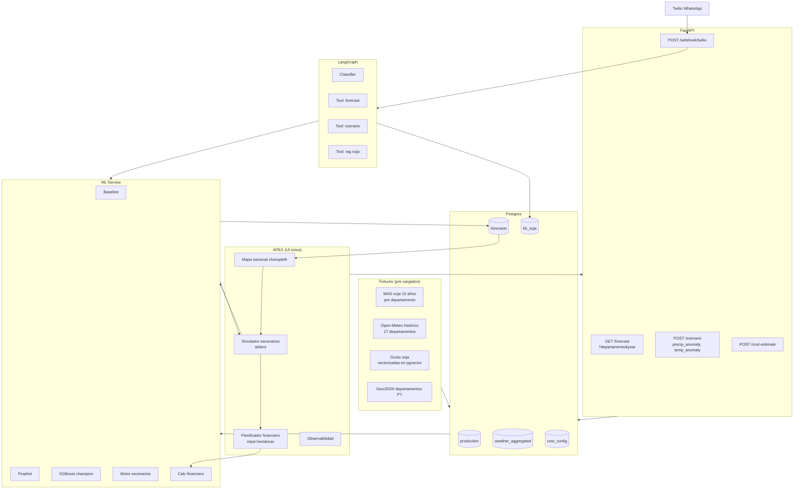
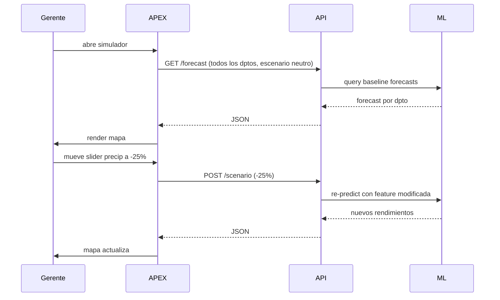
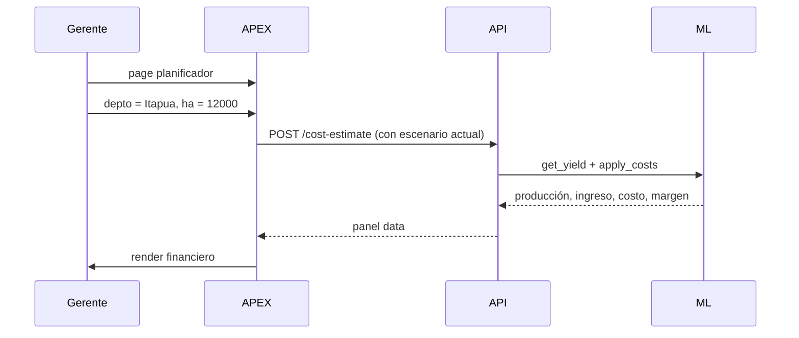
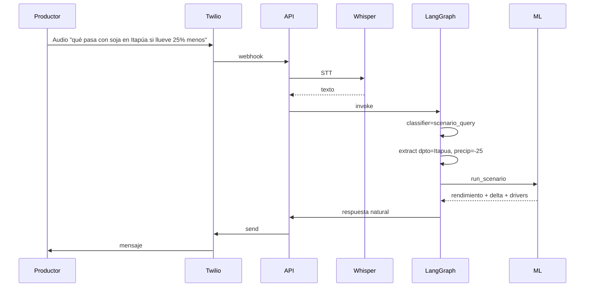
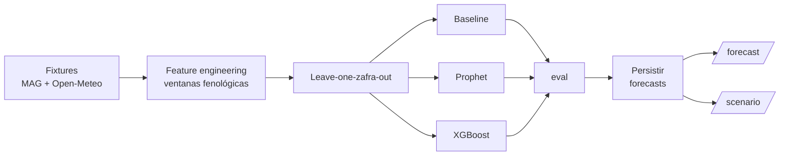

# AgroPy MVP: forecast de soja con motor de escenarios climáticos

> Versión POC para hackaton. Un cultivo (soja), forecast por departamento con baseline + Prophet + XGBoost, motor de escenarios climáticos en vivo (sliders precipitación/temperatura), planificador financiero simple, agente WhatsApp con dos intents. Sin multi-tenant, sin auth real, sin guaraní, sin alertas en cron. Datos del MAG y Open-Meteo descargados como fixtures.

> Para la narrativa completa del producto (multi-cultivo, soporte guaraní, alertas proactivas, datos por finca), ver `AGRO_cosechas.md`. Este documento es el plan de ejecución del hackaton.

---

## 1. TL;DR

El MVP demuestra el ciclo de planificación de zafra para soja en Paraguay:
1. Gerente de cooperativa abre APEX, ve mapa nacional con forecast de rendimiento (kg/ha) por departamento.
2. Mueve sliders de anomalía de precipitación y temperatura, mapa actualiza en vivo el rendimiento esperado.
3. Ingresa hectáreas sembradas en su zona, ve panel financiero: producción, ingreso bruto, costo, margen.
4. Productor pregunta por WhatsApp "qué se espera de soja en Itapúa", agente responde.
5. Productor pregunta "qué pasa si llueve 25% menos en Itapúa", agente corre escenario y devuelve número.

**Decisión clave:** soja como único cultivo. Los datasets MAG están en Excel descargable directo. Open-Meteo histórico es gratis y sin auth. No requiere onboarding del cliente para el MVP (advisory público).

---

## 2. Scope MVP

### Dentro

| Componente | Implementación MVP |
|---|---|
| Pipeline ingesta | MAG soja (Excel) + Open-Meteo histórico, ETL Python |
| Modelo predictivo | Baseline + Prophet + XGBoost para rendimiento soja por departamento |
| Motor de escenarios | Re-evaluación del modelo con features climáticas modificadas |
| Calculadora financiera | Costos por hectárea con valores referenciales editables |
| APEX dashboard | Mapa nacional + simulador con sliders + planificador financiero |
| Agente WhatsApp | 2 intents: forecast departamental, escenario what-if |
| RAG | Guías de manejo de soja del MAG/IPTA (corpus pequeño curado) |
| Eval suite | 8 queries doradas |
| Tests | unit en módulos ML core |

### Fuera (queda en el spec narrativo)

| Componente | Por qué se saca |
|---|---|
| Multi-cultivo (maíz, trigo, tomate) | Solo soja. Cobertura natural luego de validar pipeline |
| Onboarding por finca | MVP opera sobre data agregada pública |
| Soporte guaraní | Solo español. Whisper y respuestas en español |
| Auth real | No hay personalización por usuario en MVP |
| Multi-tenant | No aplica |
| Alertas proactivas en cron | Botón "evaluar alerta" en APEX simula el flow |
| Integración USDA/commodities | Precios hardcoded para el demo |
| Mapa interactivo de fincas | Mapa nacional por departamento solo |

---

## 3. Stack

| Capa | Tecnología |
|---|---|
| Backend | Python 3.12, FastAPI, Pydantic |
| DB | PostgreSQL 16 + pgvector |
| LLM orchestration | LangGraph |
| LLMs | Gemini 2.5 Flash (clasificador), Bedrock Claude (generación) |
| Embeddings | OpenAI text-embedding-3-small |
| ML | scikit-learn, statsmodels, Prophet, XGBoost |
| Clima | Open-Meteo API (HTTP directo) |
| Mensajería | Twilio WhatsApp sandbox |
| STT | OpenAI Whisper |
| Dashboard | Oracle APEX + APEX maps |
| Tests | pytest |

---

## 4. Arquitectura MVP



---

## 5. Componentes en detalle

### 5.1 Pipeline de ingesta (fixtures)

**Datos productivos MAG soja:**
- Descargar Excel de datos.gov.py: superficie, producción, rendimiento por departamento, últimos 10 años
- Limpieza: pasar a long format `(departamento, año, superficie_ha, produccion_tn, rendimiento_kg_ha)`
- Persistir en tabla `production`

**Datos climáticos Open-Meteo:**
- Para cada departamento de Paraguay, identificar coordenadas centroide
- Descargar histórico Open-Meteo de los últimos 10 años por coordenada
- Agregar por ventana fenológica de soja: precipitación acumulada oct-mar, temperatura promedio en floración (ene), días con T > 35°C en llenado de grano (feb-mar)
- Persistir en tabla `weather_aggregated`

**Output:** dos CSVs listos para `\copy`. Pre-trabajo cuestion de horas, no se hace en hackaton.

### 5.2 Modelo predictivo

**Target:** rendimiento de soja (kg/ha) por departamento y zafra futura.

**Features:**
- Históricas productivas: rendimiento últimas 3, 5, 10 zafras; tendencia linear
- Climáticas agregadas: precip_total_mm, precip_anomaly_pct vs mediana histórica del departamento, temp_avg_c, heat_stress_days
- Departamento (one-hot encoded)

**Modelos entrenados:**

1. Baseline: media histórica por departamento, sin features
2. Prophet con regressors climáticos
3. XGBoost multivariado (champion esperado)

**Validación:** leave-one-zafra-out. Entrenar con todas las zafras menos la última disponible, validar en la última. Reportar MAE y MAPE por departamento.

**Métricas reportadas:**

| Modelo | MAE (kg/ha) | MAPE | Mejor que baseline (%) |
|---|---|---|---|
| Baseline | X | X% | - |
| Prophet | X | X% | -X% |
| XGBoost | X | X% | -X% |

### 5.3 Motor de escenarios (diferenciador clave)

**API:**
```python
POST /scenario
{
  "departamento": "Itapua",
  "zafra_year": 2026,
  "precip_anomaly_pct": -25.0,  # 25% menos que mediana
  "temp_anomaly_c": 1.5,         # 1.5C sobre mediana
  "heat_stress_days_extra": 5
}
```

**Implementación:** toma el modelo champion (XGBoost), modifica las features climáticas según el escenario, re-predice. Devuelve nuevo rendimiento + delta vs forecast neutro + descomposición por contribución de cada feature (SHAP local opcional).

**Output:**
```json
{
  "predicted_yield_kg_ha": 2620,
  "ci_low": 2350,
  "ci_high": 2890,
  "delta_vs_baseline": -560,
  "delta_pct": -17.6,
  "main_drivers": [
    {"feature": "precip_anomaly_pct", "contribution": -380},
    {"feature": "heat_stress_days", "contribution": -180}
  ]
}
```

### 5.4 Calculadora financiera

Tabla `cost_config` con valores por defecto editables:

```
soja: 800 USD / ha (semilla, fertilizante, herbicidas, cosecha)
precio_referencia_usda: 380 USD / tn (zafra anterior, hardcoded)
```

**Cálculo:**
```
producción_total = rendimiento_kg_ha * superficie_ha / 1000  # toneladas
ingreso_bruto = producción_total * precio_referencia_usda
costo_total = costo_ha * superficie_ha
margen = ingreso_bruto - costo_total
```

Render en panel APEX con: producción, ingreso bruto, costo total, margen, margen / ha.

### 5.5 APEX dashboard

**Page 1 - Mapa nacional:** APEX maps con GeoJSON de departamentos paraguayos. Cada departamento coloreado según forecast de rendimiento de soja. Selector de zafra (2026, 2027). Tooltip con número.

**Page 2 - Simulador de escenarios:** dos sliders (precipitación anomaly %, temperatura anomaly °C), input para días de estrés extras. Al mover sliders, fetch a `/scenario` por todos los departamentos, mapa actualiza. Tabla lateral muestra ranking de departamentos por impacto del escenario.

**Page 3 - Planificador financiero:** selector de departamento, input de superficie en hectáreas, fetch a `/cost-estimate`, render de panel: producción, ingreso, costo, margen. Toggle entre "escenario neutro" y "escenario actual de simulador".

**Page 4 - Observabilidad:** latencia, costo USD por turno, eval metrics, modelo champion vigente y su MAE.

### 5.6 Agente WhatsApp

**Estado mínimo:**
```python
class AgroAgentState(TypedDict):
    messages: list[BaseMessage]
    last_scenario: dict | None
    intent: str | None
```

**Sin auth/scope:** demo en español, cualquiera puede preguntar.

**Intents:**
1. `forecast_query`: extrae departamento, llama tool, devuelve rendimiento + banda
2. `scenario_query`: extrae parámetros del escenario en lenguaje natural ("si llueve 25% menos"), llama tool, devuelve resultado
3. `clinical_question` (en agro: agronómica): RAG sobre `kb_soja`, devuelve guía citada

**Tools:**
- `get_forecast(departamento: str)`: query a `/forecast`
- `run_scenario(departamento, precip_anom, temp_anom)`: query a `/scenario`
- `rag_search(query)`: vector search sobre `kb_soja`

---

## 6. Modelo de datos MVP

```sql
-- Producción histórica MAG (soja)
CREATE TABLE production (
    id BIGSERIAL PRIMARY KEY,
    departamento VARCHAR NOT NULL,
    zafra_year INT NOT NULL,
    superficie_ha FLOAT,
    produccion_tn FLOAT,
    rendimiento_kg_ha FLOAT,
    UNIQUE(departamento, zafra_year)
);

-- Clima agregado por ventanas fenológicas
CREATE TABLE weather_aggregated (
    departamento VARCHAR,
    zafra_year INT,
    precip_total_mm FLOAT,
    precip_anomaly_pct FLOAT,  -- pct vs mediana histórica del depto
    temp_avg_c FLOAT,
    temp_anomaly_c FLOAT,
    heat_stress_days INT,
    PRIMARY KEY (departamento, zafra_year)
);

-- Forecasts persistidos
CREATE TABLE forecasts (
    id BIGSERIAL PRIMARY KEY,
    model_version VARCHAR,
    departamento VARCHAR,
    target_zafra INT,
    predicted_yield_kg_ha FLOAT,
    ci_low FLOAT,
    ci_high FLOAT,
    scenario JSONB,  -- null si es baseline
    generated_at TIMESTAMPTZ DEFAULT now()
);

-- Configuración de costos
CREATE TABLE cost_config (
    cultivo VARCHAR PRIMARY KEY,
    cost_usd_ha FLOAT,
    price_usd_ton FLOAT,
    notes TEXT
);

-- Knowledge base soja
CREATE TABLE kb_soja (
    id BIGSERIAL PRIMARY KEY,
    chunk TEXT,
    embedding VECTOR(1536),
    source VARCHAR,
    metadata JSONB
);
CREATE INDEX idx_kb_embedding ON kb_soja USING ivfflat (embedding vector_cosine_ops);
```

---

## 7. Flujos del demo

### 7.1 Gerente abre simulador y mueve sliders



### 7.2 Gerente ingresa hectáreas



### 7.3 WhatsApp con escenario natural language



---

## 8. Casos de uso del demo

**UC1: Gerente abre el mapa nacional.** APEX page mapa: 17 departamentos coloreados según forecast de rendimiento de soja zafra 2026. Alto Paraná verde (3.180 kg/ha), Itapúa verde claro (3.050), Caaguazú amarillo (2.700). Tooltip al pasar mouse.

**UC2: Gerente prueba escenario seco.** Mueve slider precipitación a -25%, mapa actualiza en vivo. Alto Paraná baja a 2.620 kg/ha, Itapúa a 2.520. Tabla lateral muestra ranking: Caaguazú es el más impactado.

**UC3: Planificación financiera.** Gerente cambia a page 3, selecciona Alto Paraná, ingresa 12.000 hectáreas. Panel: producción 31.440 tn, ingreso bruto USD 11.94M, costo total USD 9.6M, margen USD 2.34M, margen/ha USD 195.

**UC4: Productor pregunta por WhatsApp.** Audio: "qué se espera de soja en Itapúa este año". Agente responde: "Para soja zafra 2026 en Itapúa el modelo proyecta 3.050 kg/ha, banda 2.700 a 3.300. Drivers principales: precipitación favorable los últimos 60 días."

**UC5: Productor pregunta escenario.** Audio: "y si llueve 25% menos qué pasa". Agente extrae el escenario, corre simulación, responde: "Con 25% menos lluvia el rendimiento esperado baja a 2.520 kg/ha, una caída de 17%. La precipitación contribuye con la mitad de esa caída, el resto es estrés térmico esperado."

---

## 9. Pipeline ML mínimo



---

## 10. Fixtures necesarios (pre-trabajo)

### Fixture 1: MAG producción soja

Descargar de datos.gov.py el Excel de superficie, producción y rendimiento. Limpiar, pasar a long format, output `fixtures/production_soja.csv`. ~170 filas (17 dptos x 10 zafras).

### Fixture 2: Open-Meteo histórico agregado

Script Python que para cada departamento de Paraguay (centroide en GeoJSON) descarga 10 años de histórico Open-Meteo, agrega por ventana fenológica de soja (oct-mar), persiste en `fixtures/weather_aggregated.csv`. ~170 filas.

### Fixture 3: Knowledge base de manejo de soja

Curar 5-10 documentos del MAG/IPTA sobre manejo de soja: siembra, fertilización, plagas, manejo de sequía. Chunkear, embeddear, persistir en `kb_soja`. ~50 chunks esperados.

### Fixture 4: APEX workspace + GeoJSON

- Workspace APEX configurado con conexión a Postgres
- GeoJSON de departamentos paraguayos cargado en APEX maps
- 4 páginas vacías creadas

### Fixture 5: cost_config defaults

Insert manual con valores referenciales para soja:
- cost_usd_ha = 800
- price_usd_ton = 380

---

## 11. Plan de 8 horas

| Hora | Hito | Notas |
|---|---|---|
| 0:00-0:30 | Setup repo, fork base WhisperDocs, env, DB up con fixtures cargados | Pre-trabajo crítico |
| 0:30-1:00 | APEX: workspace + GeoJSON cargado, page mapa básica | |
| 1:00-2:30 | ML: feature engineering, baseline + Prophet + XGBoost, eval con leave-one-zafra-out | Notebook + script |
| 2:30-3:00 | Endpoint `/forecast`, persistir resultados | |
| 3:00-4:00 | Motor de escenarios: endpoint `/scenario` con re-predict | |
| 4:00-5:00 | APEX page 2: simulador con sliders, fetch en vivo a `/scenario`, mapa update | Crítico que sea responsivo |
| 5:00-5:45 | APEX page 3: planificador financiero con input ha + render panel | |
| 5:45-6:45 | Agente LangGraph: classifier, tools forecast + scenario + rag, integración WhatsApp | Twilio sandbox |
| 6:45-7:15 | Eval suite: 8 queries doradas, run | |
| 7:15-7:45 | APEX page 4 observabilidad + README + ADRs | |
| 7:45-8:00 | Buffer / fix de última hora | |

---

## 12. Demo arc (90 segundos)

```
[0:00] "Es marzo. Cooperativa de Alto Paraná planifica zafra de soja 25/26."

[0:08] (APEX) Mapa nacional. 17 departamentos coloreados según forecast.
       Alto Paraná 3.180 kg/ha. Hover muestra detalle.

[0:22] Cambio a page simulador. Slider precipitación: arrastra a -25%.
       Mapa actualiza en vivo, todos los departamentos bajan.
       Alto Paraná pasa a 2.620 kg/ha. Tabla muestra ranking.

[0:38] Slider temperatura: +1.5°C. Caaguazú es el más impactado.

[0:48] Cambio a planificador. Selecciona Alto Paraná, ingresa 12.000 ha.
       Panel financiero: producción 31.440 tn, margen USD 2.34M.
       Click en toggle "escenario actual" baja margen a USD 1.42M.

[1:08] (Cambio a celular) Productor manda audio:
       'qué se espera de soja en Itapúa este año'.

[1:18] Agente responde: 'Para soja zafra 26 en Itapúa el modelo proyecta
       3.050 kg/ha, banda 2.700 a 3.300. Las precipitaciones recientes
       están sobre la mediana, eso es favorable.'

[1:28] Productor: 'y si llueve 25% menos'.

[1:35] Agente corre escenario: 'Con 25% menos lluvia el rendimiento baja
       a 2.520 kg/ha, una caída de 17%. La precipitación contribuye con
       la mitad de la caída.'

[1:45] (Vuelta a APEX) Page de observabilidad: latencia p50 1.5s,
       costo USD por turno $0.004, MAE de XGBoost 280 kg/ha
       (-22% vs baseline). Eval suite passing 7/8.

[1:55] 'Pipeline end-to-end: forecast departamental, motor de escenarios
       en vivo, planificación financiera, agente conversacional.
       Multi-cultivo y onboarding por finca están en el roadmap.'
```

---

## 13. Cobertura del brief

| Pilar técnico | Cobertura MVP |
|---|---|
| Python y API | FastAPI, agente, ML pipeline, motor de escenarios |
| Orquestación LLM | LangGraph con 3 tools, RAG sobre guías de soja |
| Oracle APEX | 4 páginas: mapa, simulador, financiero, obs |
| Pipelines de ML | 3 modelos comparados, leave-one-zafra-out, métricas honestas |

| Eje | Cobertura |
|---|---|
| Automatización empresarial | Planificación financiera de zafra |
| Inteligencia predictiva (agro) | Core, soja con 3 modelos |
| Paneles inteligentes | APEX con mapa interactivo y simulador en vivo |

---

## 14. Pros y cons del MVP

### Pros

1. **Demoable en 8 horas con fixtures pre-cargados.**
2. **Datos reales públicos.** No requiere síntesis. MAG y Open-Meteo son fuentes legítimas.
3. **Motor de escenarios es el highlight visual.** Sliders en vivo es vendible para Isaac.
4. **No hay onboarding del cliente requerido.** El advisory público es completo en MVP.
5. **Cobertura clean de los 4 pilares del brief.**
6. **Pipeline ML bien definido.** XGBoost es el sweet spot para tabular pequeño.
7. **APEX maps con GeoJSON es visualmente impactante.**
8. **Reusa al máximo WhisperDocs base.**
9. **Sin riesgo regulatorio.** No hay PHI ni datos personales.
10. **Demo cierra en 90s con momentos memorables** (sliders, cambio a panel financiero).

### Cons

1. **Solo soja.** Si jurado pregunta por maíz o trigo, queda como roadmap.
2. **Anual = pocos puntos.** ~170 filas para entrenar. XGBoost rinde, pero bandas amplias.
3. **No hay CRUD operativo real.** A diferencia de EpiPy MVP, acá no hay carga de datos diaria. Es un dashboard analítico sobre data pre-existente.
4. **El moat de datos no se demuestra.** Vive en la narrativa del spec completo.
5. **Sin auth ni multi-tenant, demo se siente más "tablero" que "plataforma".**
6. **APEX maps con GeoJSON puede dar problemas.** Riesgo medio en demo.
7. **Sliders dependen de latencia del backend.** Si `/scenario` toma 3s+, la UX se siente lenta.
8. **Sin guaraní.** Aunque era marketing más que feature, lo señala como Paraguay-specific menos.
9. **Forecast a nivel departamento es genérico.** No le habla a un productor específico, solo a alguien que opera a nivel agregado.
10. **Cobertura del eje "automatización empresarial" es más débil que en EpiPy.** Solo financial planning, no hay workflow operativo.

---

## 15. Comentarios de diseño y trade-offs

### 15.1 Por qué soja y no maíz

Soja tiene la serie histórica más completa en MAG, es el cultivo de mayor exportación de Paraguay (PIB), tiene precios USDA accesibles, y ventanas fenológicas bien documentadas. Maíz queda como segunda zafra natural a agregar. Trigo es zafriña, granularidad distinta.

### 15.2 Por qué motor de escenarios es el highlight

El forecast puntual con bandas amplias no impresiona porque la incertidumbre es honesta y eso se ve mediocre en demo. Los escenarios convierten esa misma incertidumbre en una herramienta de exploración: "movés un slider y ves qué pasa". Eso es mejor experiencia y comercialmente más vendible.

### 15.3 Por qué clima es core en agro pero no en salud

En salud semanal, la estacionalidad anual de Paraguay absorbe la señal climática. En agro por zafra, el clima del año específico es lo que distingue una buena cosecha de una mala. Las anomalías reales del año actual sí mueven el rendimiento, no solo la mediana histórica.

### 15.4 Por qué solo dashboard analítico, sin CRUD

Para tener CRUD agro real (carga de cosecha, registro por finca, etc.) hay que resolver el onboarding por cliente, que es costoso. El MVP demuestra el "advisory público" que opera sobre data agregada y no requiere onboarding. Esto baja el efecto de "plataforma operativa" pero lo hace ejecutable en 8h.

### 15.5 Sobre el riesgo de latencia en el simulador

Cada movimiento de slider hace un fetch a `/scenario` por los 17 departamentos. Si cada uno toma 100ms, la respuesta total puede ser 1.7s. Mitigación: pre-computar grilla de escenarios comunes (ej. precip [-30, -20, -10, 0, +10, +20, +30] x temp [-1, 0, +1, +2]) y hacer interpolación. Así el slider responde instantáneo. Si el tiempo no alcanza, dejarlo síncrono y aceptar la latencia.

### 15.6 Sobre fixtures vs datos en vivo

Open-Meteo en vivo es perfectamente factible (gratis, sin auth) pero agregar la lógica de fetch + cache + agregación durante el hackaton consume tiempo. Pre-cargar como fixture es más seguro. Si en producción se quiere data en vivo, es una migración trivial.

### 15.7 Migration path al spec completo

Cuando el MVP funcione:
1. Agregar más cultivos (maíz, trigo, tomate). Pipeline es el mismo, solo más fixtures.
2. Onboarding por finca: form en APEX para que cooperativas registren sus campos. Modelos personalizados sobre datos del cliente.
3. Auth real con multi-tenant.
4. Guaraní vía LLM post-procesamiento.
5. Alertas en cron real con templates Twilio.
6. Integración USDA/commodities en vivo.

Cada paso es aditivo.

### 15.8 Comparativa MVP salud vs MVP agro

| Dimensión | EpiPy MVP | AgroPy MVP |
|---|---|---|
| Tiene CRUD operativo | Sí (carga de casos) | No (solo dashboard) |
| Datos reales públicos | Subset MSPBS | MAG + Open-Meteo completo |
| Datos sintéticos requeridos | Sí (casos clínica) | No |
| Modelos en MVP | 3 (baseline, SARIMA, XGBoost) | 3 (baseline, Prophet, XGBoost) |
| Highlight de demo | Reconciliación | Sliders de escenario |
| Componente más vistoso | Vista reconciliación | Mapa con sliders |
| Riesgo técnico mayor | APEX setup + fixtures | APEX maps + GeoJSON |
| Cobertura "automatización empresarial" | Fuerte (CRUD + recon) | Débil (solo financiero) |
| Cobertura "predictivo" | Fuerte (multi-condición en spec) | Fuerte (escenarios) |
| Cobertura "paneles inteligentes" | Media (3 dashboards) | Fuerte (mapa + simulador) |

EpiPy MVP es más completo en cobertura de ejes (especialmente "automatización empresarial" gracias al CRUD). AgroPy MVP es más vistoso en demo pero más débil estructuralmente. Si el equipo apuesta a accuracy ML, AgroPy. Si apuesta a workflow operativo, EpiPy.
