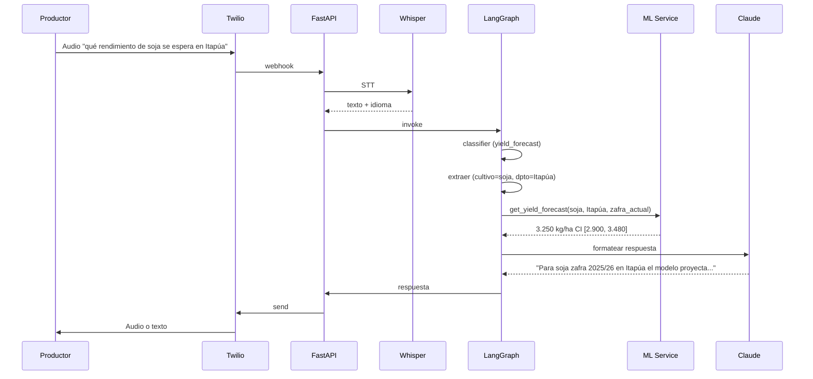
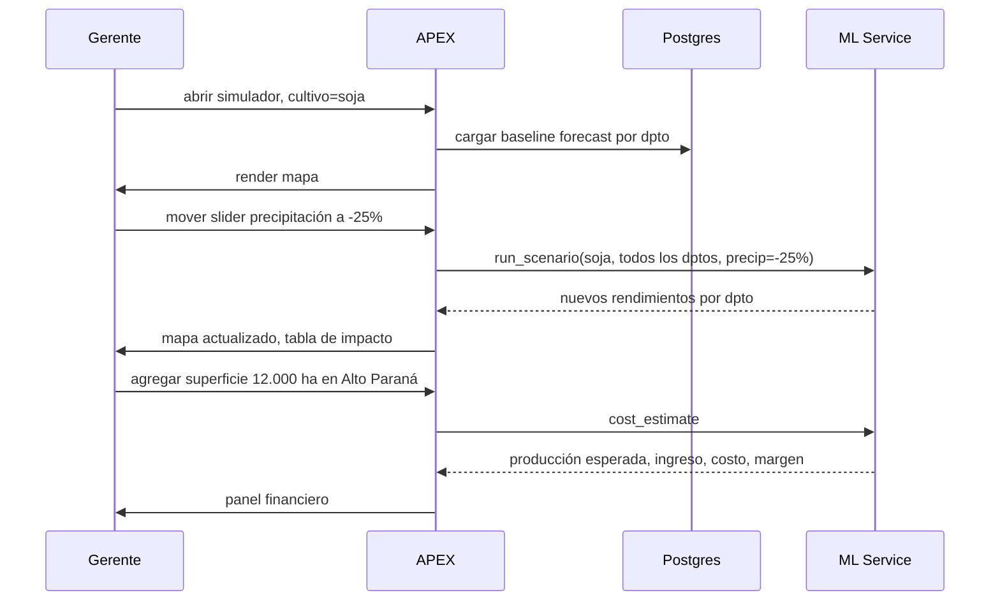
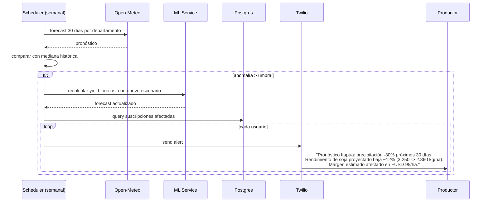
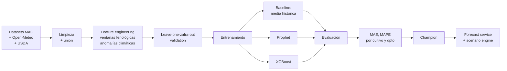

# AgroPy: Inteligencia predictiva de cosechas para cooperativas y productores paraguayos

> Sistema de predicción de rendimiento por cultivo y departamento, con planificación de costos de zafra, análisis de sensibilidad climática, dashboard para gerentes de cooperativas, y agente conversacional por WhatsApp para productores y técnicos de campo.

---

## 1. TL;DR

AgroPy ingiere los datasets abiertos del MAG (datos.gov.py), normaliza series históricas de superficie, producción y rendimiento por cultivo y departamento, entrena un modelo de forecast de rendimiento (kg/ha) por zafra incorporando features climáticas vía Open-Meteo y commodities internacionales, traduce la predicción a estimación de ingresos y costos por finca, expone un dashboard APEX para gerentes de cooperativas con mapa de departamentos y sensibilidad a escenarios climáticos, y un agente LangGraph por WhatsApp que responde consultas en lenguaje natural y guaraní, manda alertas cuando un escenario climático cambia significativamente la proyección.

**Diferenciador:** combina datos productivos públicos del MAG con clima histórico y forecast (Open-Meteo) y precios internacionales (USDA) en un solo pipeline. Útil para cooperativas medianas que hoy planifican zafra con planillas Excel y olfato.

---

## 2. Propuesta de valor

| Stakeholder | Dolor actual | Lo que aporta AgroPy |
|---|---|---|
| Gerente de cooperativa | Estimación de zafra basada en histórico simple, sin sensibilidad a clima | Forecast por departamento con bandas de confianza y escenarios "qué pasa si llueve 30% menos" |
| Productor mediano | Decisiones de siembra y compra de insumos sin visibilidad de tendencias | Consulta por WhatsApp en español o guaraní, recibe estimación de rendimiento y costos para su zona |
| Técnico de campo | Falta info consolidada al asesorar productores | Acceso al agente con datos por departamento y contexto histórico |
| Comprador / acopiador | Riesgo de oferta-demanda en zafra | Vista nacional de producción esperada, ranking por departamento |

---

## 3. Stack técnico

| Capa | Tecnología |
|---|---|
| API / Backend | Python 3.12, FastAPI, Pydantic, structlog |
| Persistencia | PostgreSQL 16 + pgvector (RAG), TimescaleDB (series temporales) |
| Orquestación LLM | LangGraph, AsyncPostgresSaver |
| LLMs | Gemini 2.5 Flash (clasificador, query rewrite); AWS Bedrock Claude (generación grounded), opcional traducción guaraní |
| Embeddings | OpenAI text-embedding-3-small |
| Retrieval | pgvector + tsvector + RRF |
| ML predictivo | scikit-learn, statsmodels, Prophet, XGBoost; opcional LightGBM para tabular |
| Features clima | Open-Meteo API |
| Features mercado | USDA / FAO commodities (CSV publicados) |
| Mensajería | Twilio WhatsApp |
| Audio | OpenAI Whisper (STT, soporta español; guaraní vía LLM post-procesamiento) |
| Dashboard | Oracle APEX |
| Mapas | APEX maps + GeoJSON de departamentos paraguayos (datos.gov.py) |
| Observabilidad | Prometheus, structlog |
| Tests / Eval | pytest, eval suite reproducible heredada de WhisperDocs |

---

## 4. Arquitectura general

```mermaid
flowchart TB
    subgraph Ingesta["Pipeline de ingesta"]
        mag[MAG datasets<br/>datos.gov.py]
        can[Censo Agropecuario<br/>2022]
        meteo[Open-Meteo API]
        usda[USDA / FAO<br/>commodities]
        parser[CSV / Excel parser]
        norm[Normalizador<br/>cultivo x dpto x zafra]
        mag --> parser
        can --> parser
        usda --> parser
        parser --> norm
        meteo --> norm
    end

    subgraph DB["PostgreSQL + pgvector + TimescaleDB"]
        ts[(producciones, clima)]
        kb[(guías MAG, manuales<br/>de cultivo, vectorizado)]
        meta[(jobs, conversations)]
    end

    subgraph ML["Pipeline ML"]
        baseline[Baseline:<br/>media histórica por dpto]
        prophet[Prophet con<br/>regressors climáticos]
        xgb[XGBoost multivariado]
        scenario[Motor de escenarios<br/>what-if climáticos]
        cost[Estimador de costos<br/>e ingresos]
        baseline --> scenario
        prophet --> scenario
        xgb --> scenario
        scenario --> cost
    end

    subgraph Agent["Capa agentic"]
        graph{LangGraph<br/>Agente bilingüe ES/GN}
        classifier[Intent classifier]
        tools[Tools:<br/>get_yield_forecast<br/>run_scenario<br/>get_cost_estimate<br/>rag_search]
        graph --> classifier
        classifier --> tools
        tools --> ML
        tools --> kb
    end

    subgraph UX["Interfaces"]
        apex[Oracle APEX<br/>Dashboard cooperativa]
        wpp[WhatsApp<br/>Agente conversacional]
        api[REST API + SSE]
    end

    Ingesta --> DB
    DB --> ML
    DB --> Agent
    Agent --> wpp
    ML --> apex
    DB --> apex

    alerts[Scheduler<br/>alertas climáticas]
    meteo --> alerts
    alerts --> wpp
```

---

## 5. Componentes en detalle

### 5.1 Pipeline de ingesta

**Fuentes confirmadas:**

1. **MAG en datos.gov.py** (21 datasets disponibles):
   - Superficie y rendimiento de los principales cereales en Paraguay (últimos 10 años)
   - Superficie y producción por año agrícola, según cultivo (períodos disponibles)
   - Tomate: superficie, producción y rendimiento por departamento 2007-2021
   - Producción Agrícola, Producción Pecuaria, Productos Elaborados en Finca
   - Censo Agropecuario Nacional 2022
   - Cantidad de Fincas y Superficies por Distrito de San Pedro
2. **DCEA/MAG** publicación oficial 16 principales cultivos (PDF)
3. **Open-Meteo histórico**: temperatura, precipitación, humedad, evapotranspiración, viento por coordenadas departamentales
4. **USDA Foreign Agricultural Service**: commodities globales (soja, maíz, trigo, arroz)

**Cultivos prioritarios para el MVP:**
- **Soja** (mayor exportación de Paraguay, datos más ricos)
- **Maíz** (segunda zafra en muchos departamentos)
- **Trigo** (zafriña)
- Opcional si alcanza tiempo: tomate (tiene serie 2007-2021 detallada por departamento)

**Pasos:**
1. Descargar Excel/CSV del MAG, parsear con `pandas`.
2. Normalizar a esquema canónico `(cultivo, departamento, zafra_year, superficie_ha, produccion_tn, rendimiento_kg_ha, fuente)`.
3. Para cada `(departamento, zafra_year)` agregar features climáticas agregadas por ventanas relevantes: precipitación de octubre a marzo (período crítico de soja), temperatura promedio en floración, días con temperatura > 35°C (estrés térmico).
4. Persistir en hypertable.
5. RAG: guías de manejo de cultivo del MAG/IPTA y boletines técnicos chunkeados en pgvector.

**Limitación honesta:** la granularidad del MAG es anual o por zafra. Eso significa pocos puntos por departamento (10-15 años x 17 departamentos = 170-255 puntos por cultivo). Con eso no se entrena DL serio. Se entrena un XGBoost multivariado decente, y se reportan métricas con honestidad.

### 5.2 Modelo predictivo (ML core)

**Target:** rendimiento (kg/ha) por cultivo, departamento y zafra futura.

**Features:**
- **Históricas productivas**: rendimiento promedio últimos 3, 5, 10 años; tendencia
- **Climáticas agregadas**: precipitación acumulada en ventana fenológica, temp_avg, días de estrés térmico, anomalía vs. mediana histórica
- **Contextuales**: tipo de zafra (1ra, 2da), superficie sembrada, departamento (one-hot)
- **Mercado**: precio internacional commodity en zafra anterior (proxy de inversión esperada)

**Modelos a entrenar:**

| Modelo | Propósito | Tiempo estimado |
|---|---|---|
| Baseline: media histórica por departamento | Referencia | 5 min |
| Prophet con regressors climáticos | Captura tendencia + estacionalidad inter-zafras | 15 min |
| XGBoost multivariado | Modelo champion esperado | 20 min |
| Ensemble simple (promedio) | Robustez | 5 min |

**Validación:** leave-one-zafra-out. Entrenar con todas las zafras menos la última, validar en la última. Reportar MAE y MAPE por cultivo y departamento.

**Métricas a reportar:**

| Cultivo | Modelo | MAE (kg/ha) | MAPE | Comparativa vs. baseline |
|---|---|---|---|---|
| Soja | Baseline | X | X% | - |
| Soja | Prophet | X | X% | -X% |
| Soja | XGBoost | X | X% | -X% |
| Maíz | ... | ... | ... | ... |

### 5.3 Motor de escenarios

Esto es lo que diferencia el producto de un simple forecast: dado el modelo entrenado, permitir simular escenarios climáticos.

**API conceptual:**
```python
def run_scenario(
    cultivo: str,
    departamento: str,
    zafra_year: int,
    precip_anomaly_pct: float = 0.0,      # +20 = 20% más lluvia que mediana
    temp_anomaly_c: float = 0.0,          # +1.5 = 1.5°C sobre mediana
    heat_stress_days_extra: int = 0       # días adicionales > 35°C
) -> ScenarioResult
```

**Salida:**
- Rendimiento esperado bajo el escenario (kg/ha)
- Banda de confianza
- Comparación con escenario neutro
- Producción total estimada para la superficie sembrada conocida
- Sensibilidad por feature (qué impacta más)

Esto le da al usuario una herramienta de planificación, no solo una predicción puntual.

### 5.4 Estimador de costos e ingresos

Pipeline post-modelo, configurable por usuario:

```
rendimiento_kg_ha (modelo) * superficie_ha (input usuario) = produccion_total
produccion_total * precio_tonelada (USDA o input) = ingreso_estimado
costo_ha (input usuario o tabla por defecto) * superficie_ha = costo_total
margen = ingreso_estimado - costo_total
```

**Tabla de costos por defecto** (editable en APEX, fuente DCEA/MAG):
- Soja: ~USD 800/ha (semilla, fertilizante, herbicidas, cosecha)
- Maíz: ~USD 600/ha
- Trigo: ~USD 450/ha

Estos números son ilustrativos. En el hackaton se inicializan con valores referenciales y se documenta que el usuario puede editarlos.

### 5.5 Capa agentic con LangGraph

**Estado del agente:**
```python
class AgroAgentState(TypedDict):
    messages: list[BaseMessage]
    user_role: Literal["productor", "tecnico", "gerente", "publico"]
    location_context: dict | None  # departamento, opcional
    language: Literal["es", "gn", "mixto"]
    last_forecast: dict | None
    intent: str | None
```

**Nodos del graph:**
1. `language_detector`: detecta español, guaraní o jopara (mixto)
2. `classifier`: detecta intent (`yield_forecast`, `scenario_what_if`, `cost_estimate`, `clinical_question`, `chitchat`)
3. `compactor`: comprime historia
4. `forecast_tool`: llama al servicio ML
5. `scenario_tool`: corre el motor de escenarios
6. `cost_tool`: calcula costos e ingresos
7. `rag_search`: RAG sobre guías de manejo de cultivo
8. `formatter`: Claude vía Bedrock genera respuesta grounded, en el idioma del usuario

**Soporte de guaraní (modesto, honesto):** Whisper transcribe español bien, guaraní y jopara con calidad variable. Estrategia simple: si Whisper devuelve transcripción dudosa, el agente responde en español pidiendo confirmación. La generación final puede usar Gemini para traducir respuesta clave a guaraní básico. Es feature de presentación, no core.

### 5.6 Dashboard APEX

**Páginas:**
1. **Mapa nacional**: choropleth de rendimiento esperado por departamento, selector de cultivo y zafra.
2. **Detalle departamental**: serie histórica + forecast con bandas, descomposición de features (qué pesa más).
3. **Simulador de escenarios**: sliders para precipitación, temperatura, días de estrés. Updates en vivo del rendimiento esperado y márgenes.
4. **Planificación de cooperativa**: input de superficie sembrada por finca asociada, output de producción esperada total, ingresos, costos, margen.
5. **Configuración**: ratios de costo por cultivo, precios de referencia.
6. **Observabilidad**: latencia, costo USD, eval metrics, métricas del modelo.

### 5.7 Interfaz WhatsApp

**Entrada:** texto, audio, opcional imagen (para versiones futuras: foto de cultivo).

**Salida:** texto formateado, opcional audio.

**Alertas proactivas:**
- Job semanal lee forecast climático Open-Meteo para los próximos 30 días
- Compara con la mediana histórica del período
- Si la anomalía supera umbral, recalcula forecast de rendimiento
- Si el rendimiento esperado cae más de X%, alerta a productores suscriptos en ese departamento

---

## 6. Modelo de datos

```sql
CREATE TABLE production (
    id BIGSERIAL PRIMARY KEY,
    cultivo VARCHAR NOT NULL,
    departamento VARCHAR NOT NULL,
    zafra_year INT NOT NULL,
    zafra_type VARCHAR,  -- '1ra', '2da', 'zafriña'
    superficie_ha FLOAT,
    produccion_tn FLOAT,
    rendimiento_kg_ha FLOAT,
    fuente VARCHAR,
    UNIQUE(cultivo, departamento, zafra_year, zafra_type)
);

CREATE TABLE weather_aggregated (
    departamento VARCHAR,
    zafra_year INT,
    cultivo VARCHAR,  -- distintas ventanas según cultivo
    precip_total_mm FLOAT,
    precip_anomaly_pct FLOAT,
    temp_avg_c FLOAT,
    temp_anomaly_c FLOAT,
    heat_stress_days INT,
    PRIMARY KEY (departamento, zafra_year, cultivo)
);

CREATE TABLE commodity_prices (
    commodity VARCHAR,
    year INT,
    price_usd_ton FLOAT,
    source VARCHAR,
    PRIMARY KEY (commodity, year)
);

CREATE TABLE yield_forecasts (
    id BIGSERIAL PRIMARY KEY,
    model_version VARCHAR,
    cultivo VARCHAR,
    departamento VARCHAR,
    target_zafra INT,
    predicted_yield_kg_ha FLOAT,
    ci_low FLOAT,
    ci_high FLOAT,
    scenario JSONB,  -- parámetros del escenario si aplicable
    generated_at TIMESTAMPTZ DEFAULT now()
);

CREATE TABLE cost_config (
    cultivo VARCHAR PRIMARY KEY,
    cost_usd_ha FLOAT,
    notes TEXT,
    updated_at TIMESTAMPTZ DEFAULT now()
);

CREATE TABLE alert_subscriptions (
    id UUID PRIMARY KEY,
    user_phone VARCHAR,
    user_role VARCHAR,
    departamento VARCHAR,
    cultivo VARCHAR,
    threshold_yield_drop_pct FLOAT,
    active BOOLEAN DEFAULT true
);
```

---

## 7. Flujos de uso

### 7.1 Flujo: productor consulta por WhatsApp



### 7.2 Flujo: gerente simula escenario en APEX



### 7.3 Flujo: alerta climática proactiva



---

## 8. Casos de uso detallados

**UC1: Gerente de cooperativa de Alto Paraná planifica zafra de soja.** Abre APEX, ve forecast por departamento. Su cooperativa tiene 12.000 ha en Alto Paraná, 4.000 ha en Itapúa. Ingresa estos valores en el planificador. Sistema devuelve producción esperada, ingreso bruto, costo total, margen estimado. Mueve slider de precipitación a -20% (escenario seco) para ver impacto. Toma decisión sobre seguros agrícolas y compras anticipadas de insumos.

**UC2: Productor mediano de Itapúa pregunta por WhatsApp.** Audio: "che, ¿qué rendimiento se espera para soja por mi zona este año?". Agente detecta jopara, responde en mezcla español-guaraní básica con el número y la banda de confianza. Productor pregunta seguido: "¿y si llueve poco?". Agente corre escenario seco, devuelve nuevo número y diferencia.

**UC3: Técnico de campo asesora en visita.** Abre WhatsApp, manda mensaje: "comparame rendimiento histórico y forecast de maíz en Caaguazú vs San Pedro". Agente devuelve tabla y comentario sobre tendencias.

**UC4: Acopiador planifica capacidad.** Abre APEX vista nacional, ranking de departamentos por producción esperada de soja zafra 2025/26. Identifica top 5 departamentos donde concentrar logística.

**UC5: Alerta climática.** El sistema detecta que el forecast de Open-Meteo a 30 días para Caaguazú muestra precipitación 35% bajo la mediana. Recalcula yield forecast: cae 14% para soja. Manda alerta WhatsApp a los 23 usuarios suscriptos en ese departamento con cultivo soja, incluyendo recomendación específica.

---

## 9. Pipeline ML en detalle



**Importante sobre limitaciones de datos:**

El número de observaciones por cultivo/departamento es bajo (10-15 años). Esto significa:
- Modelos profundos (DL) están descartados, no hay señal suficiente.
- XGBoost es el sweet spot por su capacidad de manejar few-shot tabular.
- Las bandas de confianza serán amplias y eso es honestidad técnica.
- El valor del producto está más en el motor de escenarios y la integración operativa que en achicar el error puntual.

Esto se documenta en el README final y en un ADR. Honestidad técnica suma puntos con jurados como Euan que detectan over-claims.

---

## 10. Plan de 8 horas

| Hora | Hito | Riesgo |
|---|---|---|
| 0:00-0:45 | Setup repo, fork base WhisperDocs, env, DB up con TimescaleDB | Bajo |
| 0:45-2:00 | Descargar datasets MAG (datos.gov.py), parseo a tabla `production`, ingest Open-Meteo histórico | Medio |
| 2:00-3:30 | Feature engineering, ventanas fenológicas por cultivo, baseline + Prophet | Medio |
| 3:30-4:30 | XGBoost, métricas, leave-one-zafra-out, persistir forecasts, motor de escenarios | Medio |
| 2:00-4:00 | (paralelo) APEX: mapa nacional + simulador de escenarios con sliders | Medio: APEX maps |
| 4:30-5:30 | Endpoint `/forecast`, `/scenario`, `/cost-estimate`, agente con tools | Bajo |
| 5:30-6:30 | WhatsApp end-to-end con Whisper, prueba de jopara | Medio |
| 6:30-7:00 | Eval suite mini, 10 queries doradas | Bajo |
| 7:00-7:30 | Demo prep, datos sembrados | Bajo |
| 7:30-8:00 | README, ADRs, video, plot de métricas | Bajo |

**Crítico:** los datasets del MAG hay que descargarlos antes del hackaton. Algunos están como Excel descargable directo, otros pueden estar fragmentados.

---

## 11. Métricas de éxito

**Técnicas:**
- MAE de XGBoost mejor que baseline en soja en al menos 15%
- Reportar MAPE por departamento, identificar dónde el modelo es confiable y dónde no
- Bandas de confianza calibradas (idealmente, validación de cobertura)
- Eval suite reproducible
- Tests > 60% cobertura en módulos core

**De producto:**
- Demo end-to-end: pregunta WhatsApp -> forecast en menos de 8 segundos
- Simulador de escenarios responsivo en APEX (< 2s por cambio de slider)
- Caso de planificación financiera concreto (cooperativa con N hectáreas, output de margen)

---

## 12. Riesgos y mitigaciones

| Riesgo | Probabilidad | Mitigación |
|---|---|---|
| Datasets MAG fragmentados o con formato variable | Alta | Pre-procesar antes; mantener un cultivo prioritario (soja) como mínimo viable |
| Pocos puntos por departamento limitan accuracy | Alta | Reportar honestamente; valor del producto vía motor de escenarios |
| APEX maps con GeoJSON puede ser quisquilloso | Media | Fallback a tabla con bullets verticales; APEX charts simples |
| Whisper falla en guaraní | Alta | Soporte mínimo, fallback a español, documentar limitación |
| Open-Meteo histórico tiene gaps regionales | Baja | Imputar con vecino más cercano |
| Modelo no supera baseline en algunos dptos | Media | Reportar transparentemente; agregación a nivel país sí debería superar |

---

## 13. Datasets y fuentes

| Fuente | URL | Uso |
|---|---|---|
| MAG datos.gov.py | datos.gov.py/group/ministerio-de-agricultura-y-ganaderia-mag | Producción, superficie, rendimiento |
| Censo Agropecuario 2022 | datos.gov.py/dataset/censo-agropecuario-nacional-can-2022 | Estructura de fincas |
| DCEA producción 16 cultivos | informacionpublica.paraguay.gov.py | Documento técnico de cultivos |
| Tomate por dpto 2007-2021 | datos.gov.py | Serie larga para cultivo opcional |
| Open-Meteo | open-meteo.com/en/docs/historical-weather-api | Clima histórico y forecast |
| USDA FAS | fas.usda.gov | Commodities globales |
| GeoJSON departamentos PY | datos.gov.py | Mapas APEX |

---

## 14. Demo de 60 segundos

```
[0:00] "Es marzo. La gerente de una cooperativa de Alto Paraná planifica la zafra 25/26."
[0:05] (APEX) Mapa nacional, soja. Alto Paraná verde con forecast 3.180 kg/ha.
[0:12] Click en Alto Paraná. Línea histórica + forecast con banda de confianza.
       Descomposición: precipitación pesa 38%, temperatura 22%, tendencia 15%.
[0:20] Mueve slider precipitación a -25%. Mapa actualiza en vivo. 
       Alto Paraná pasa a 2.620 kg/ha. Diferencia: -560 kg/ha.
[0:28] Ingresa superficie 12.000 ha. Panel financiero: 
       producción 31.440 toneladas, ingreso bruto USD X, costo USD Y, margen Z.
[0:35] (Cambio a celular) Productor manda audio: "qué se espera para soja en mi zona, Itapúa".
[0:42] Agente responde: "Para soja zafra 25/26 en Itapúa el modelo proyecta 
       3.050 kg/ha, banda 2.700 a 3.300. Las precipitaciones de los últimos 60 días
       están 8% sobre la mediana, eso es favorable."
[0:52] (APEX vista observabilidad) Eval suite metrics, costo USD por turno, latencia.
[0:58] "Datos públicos del MAG, clima Open-Meteo, ML reportado con métricas honestas."
```

---

## 15. Cobertura del brief del hackaton

| Pilar técnico | Cobertura |
|---|---|
| Python y API | FastAPI, agente, ML pipeline, ingesta, motor de escenarios |
| Orquestación LLM | LangGraph con tool calling, RAG sobre guías de cultivo |
| Oracle APEX | Dashboard nacional, simulador de escenarios, planificador financiero |
| Pipelines de ML | Forecast Prophet + XGBoost con baseline honesto, leave-one-zafra-out |

| Eje de desafío | Cobertura |
|---|---|
| Automatización empresarial | Planificación de zafra, alertas climáticas |
| Inteligencia predictiva (agro) | Core del proyecto |
| Paneles inteligentes | APEX con simulador en vivo |

**Para el juez IA del repo:**
- README con diagramas Mermaid, badges, quickstart
- ARCHITECTURE.md, ADRs explicando decisiones (XGBoost vs DL, ventanas fenológicas, etc.)
- Tests, eval suite, métricas Prometheus
- Honestidad técnica documentada: limitaciones de datos, dónde el modelo es confiable

---

## 16. Pros y cons

### Pros

1. **Datos públicos limpios y disponibles.** Los datasets MAG en datos.gov.py son CSV/Excel directos, no requieren parseo de PDF complejo.
2. **Mercado más rápido que B2G.** Cooperativas y productores grandes deciden compras de software con ciclo de meses, no años.
3. **Clima como feature core es legítimo.** A diferencia de salud, en agro el clima realmente determina el rendimiento del año en curso. El motor de escenarios "qué pasa si llueve 25% menos" es producto vendible.
4. **Sector estratégico paraguayo** (PIB agro >60% de exportaciones). Conexión emocional con jurado local.
5. **Pipeline ML defendible** con XGBoost sobre tabular pequeño. No se pretende DL, se reporta honestamente.
6. **Bajo riesgo regulatorio.** No hay PHI, no hay licitaciones complejas.
7. **APEX dashboard con sliders interactivos** es visualmente atractivo para Isaac.
8. **Reusa WhisperDocs base** para agente, RAG, eval, observabilidad.
9. **Soporte de guaraní** como detalle memorable, aunque sea modesto.
10. **Demo de 60 segundos cierra rápido** (rendimiento + escenario + financiero).

### Cons

1. **Onboarding del cliente real es complejo.** Una cooperativa para usar AgroPy más allá del dashboard agregado necesita cargar superficie por finca, costos reales, perfiles de cultivo, datos de suelo, riego, abonado. Es trabajo de field sales, no auto-servicio. **Este es el problema estructural más importante del proyecto.** Para hackaton no impacta porque el demo opera sobre data agregada pública. Para producto real impacta en go-to-market.
2. **Datos por zafra anual** = pocos puntos por departamento (10-15 años x 17 departamentos = 170-255 observaciones por cultivo). Limita performance del modelo. DL descartado.
3. **Bandas de confianza serán amplias.** Hay que reportarlo y aceptarlo.
4. **No hay baseline académico paraguayo citable comparable a FPUNA en salud.**
5. **Sector privado fragmentado.** No hay un anchor customer obvio como MSPBS en salud. Más cooperativas, menos concentración.
6. **APEX maps con GeoJSON puede ser quisquilloso.** Riesgo medio en demo.
7. **Whisper y guaraní es marketing más que feature.** La calidad de transcripción en guaraní es variable.
8. **Cobertura de los ejes del brief es algo más débil que salud.** "Automatización empresarial" en agro se siente más forzado que en salud (donde hay CRUD operativo real).
9. **El motor de escenarios depende de calidad del modelo.** Si el modelo es mediocre, los escenarios también lo son. El "what-if" no rescata un mal forecast.
10. **Sin componente CRUD claro,** la demo se siente más "tablero analítico" que "plataforma operativa", lo cual baja el valor de APEX en este proyecto.

---

## 17. Comentarios y aclaraciones de diseño

### 17.1 Sobre el problema de onboarding

Es el con #1 y vale la pena ampliar. AgroPy genérico, sin onboarding profundo, sirve para:
- Dashboard agregado nacional/departamental (no requiere data del cliente)
- Forecast departamental (no requiere data del cliente)
- Simulador de escenarios (opera sobre data agregada)
- Consultas WhatsApp al agente sobre datos públicos

Pero NO sirve sin onboarding para:
- Recomendación específica a la finca de un productor
- Predicción de rendimiento ajustado a la realidad del campo individual
- Estimación financiera sobre costos reales del cliente
- Alertas sobre el portfolio específico del cliente

Esto significa que el producto tiene dos capas: una "advisory pública" (low touch, escalable, baja diferenciación) y una "personalizada" (high touch, alto valor, requiere field sales). El demo del hackaton vive en la primera capa, lo cual está bien para el evento. Para el pitch a Isaac hay que tener clara esta distinción y la estrategia de monetización por capa.

### 17.2 Por qué el clima sí es core acá (a diferencia de salud)

En salud semanal, la estacionalidad anual de Paraguay absorbe la señal climática. En agro por zafra, el clima del año específico es lo que distingue una buena cosecha de una mala. Las ventanas fenológicas (floración, llenado de grano) son sensibles a anomalías reales, no a la mediana histórica. Por eso Open-Meteo es feature primaria en AgroPy, no opcional.

### 17.3 Por qué granularidad anual no permite SARIMA tradicional

SARIMA necesita observaciones suficientes para captar estacionalidad. Con datos anuales por zafra, la estacionalidad anual no se ve (cada observación es ya un agregado anual). Por eso el modelo champion es XGBoost sobre features ingenierizadas (no SARIMA). Documentado en ADR.

### 17.4 Sobre el motor de escenarios como diferenciador

El forecast puntual con bandas amplias no se vende solo. El motor de escenarios sí: permite al cliente explorar el espacio de posibilidades, no solo recibir un número. Esto es mejor UX para planificación y se compensa por la incertidumbre del modelo.

### 17.5 Sobre el WhisperDocs base

Igual que en EpiPy, AgroPy hereda de WhisperDocs:
- Agentic RAG con LangGraph
- Hybrid retrieval, eval suite, costos, métricas
- WhatsApp Twilio
- Tests layered

Sobre eso construye:
- Pipeline ML específico de agro
- Motor de escenarios
- APEX dashboards
- Estimador financiero
- Soporte parcial guaraní

### 17.6 Si tuvieras que elegir solo uno

Comparado con EpiPy multi-tenant:

| Dimensión | EpiPy (salud) | AgroPy (agro) |
|---|---|---|
| Cobertura del brief | Más fuerte (CRUD, multi-tenant, multi-condición) | Más débil (advisory público) |
| Riqueza de datos | Alta (semanal por distrito + tenant) | Media (anual por departamento) |
| Modelo más sofisticado en 8h | XGBoost + SARIMA + Prophet por condición | XGBoost + Prophet |
| Onboarding del cliente | Estandarizado (forms en APEX) | Complejo (parámetros por finca) |
| APEX en rol load-bearing | Sí (CRUD, dashboards, RLS) | Parcial (solo dashboards) |
| Mercado | Mixto B2B/B2G con anchor MSPBS | B2B fragmentado |
| Riesgo regulatorio | Medio (PHI roadmap) | Bajo |
| Demo más impactante | Multi-tenant + reconciliación | Sliders + financiero |
| Conexión emocional jurado local | Alta (epidemia presente) | Alta (PIB agro) |
| Diferenciador técnico clave | Reconciliación con público | Motor de escenarios |
| Probabilidad de victoria estimada | Más alta | Media |

EpiPy es la apuesta más segura para el hackaton. AgroPy es válido si por alguna razón EpiPy no cierra (ej. datos sintéticos no salen plausibles, APEX con RLS no levanta a tiempo).

