# AgroBuy: Copiloto Inteligente de Compras para Cooperativas Agro Paraguayas

> Plan ejecutable definitivo. Verticalización del desafío oficial "Copiloto Inteligente de Compras" al sector cooperativas agro paraguayas. **Este es el único plan vinculante.** El plan genérico anterior (`COMPRAS_plan.md`) queda como referencia técnica de respaldo.

---

## 1. Resumen del proyecto

**AgroBuy** es un copiloto inteligente de compras que asiste al equipo de adquisiciones de una cooperativa agro paraguaya en el ciclo completo de procurement de insumos críticos: **registrar solicitud → cargar cotizaciones de proveedores agro → comparar normalizadamente → recibir recomendación justificada → generar mensaje de negociación**.

**Verticalización al sector agro paraguayo:**
- Catálogo enfocado en insumos críticos: fertilizantes, semillas, agroquímicos, maquinaria, repuestos, combustible
- Catálogo de proveedores ficticios (Proveedor Agro 1 a 10) modelado sobre el mercado agro paraguayo
- Cooperativas agro como cliente (la demo usa la Cooperativa Coopagro, ficticia)
- Criterios de evaluación específicos al sector: precio, plazo crítico de zafra, cumplimiento histórico, certificaciones técnicas, soporte agronómico
- ML predictor calibrado a comportamiento de proveedores de insumos agro

**Cumple el desafío oficial al 100%:**
- ✅ Aplicación en **Oracle APEX**
- ✅ Registra solicitudes, proveedores, cotizaciones
- ✅ Compara automáticamente con normalización inteligente (IVA, envío, moneda)
- ✅ Genera **recomendación justificada multicriterio**
- ✅ Produce **mensaje de negociación asistido por IA**
- ✅ Multi-rol coherente

**Diferenciadores competitivos (vs probables soluciones genéricas):**
1. **Vertical agro** = sabor local visceral (Gonzalo + Isaac)
2. **ML predictivo real** de cumplimiento de proveedor (XGBoost) que alimenta al recomendador
3. **Anomaly detection** sobre precios calibrado a rangos publicados de fertilizantes y agroquímicos
4. **Integración con calendario de zafra** (urgencia se interpreta en contexto fenológico)
5. **Mensaje de negociación con tono agro paraguayo** (vocabulario específico del sector)
6. **Dual scoring climático-comercial:** *Urgency Score* (riesgo climático + cobertura de stock + volatilidad de mercado) + *Offer Score* (proveedor + términos + riesgo de entrega), con matriz de decisión explicable. Esto es lo que distingue una recomendación inteligente de un comparador de cotizaciones tradicional.
7. **Integración con APIs climáticas abiertas** (Open-Meteo como capa principal, ECMWF como backup) para señalar presión sobre disponibilidad y precios — sin pretender predecir precios exactos.

---

## 2. Caso de uso central: Cooperativa Coopagro compra urea para zafra de soja

**Contexto del demo:**

Cooperativa Coopagro, ubicada en Itapúa, tiene 1,200 socios productores con superficie agregada de ~85,000 hectáreas de soja. La gerencia de compras prepara la pre-zafra de la campaña 2026/27 (septiembre 2026 a marzo 2027). Necesita comprar fertilizantes, semillas y herbicidas con anticipación para distribuir a socios al costo cooperativo.

**Solicitud demo:** "Compra de 800 toneladas de urea granulada 46% N para distribución a socios en pre-siembra zafra soja 26/27. Plazo crítico: entrega antes del 15 de septiembre 2026 (inicio ventana de siembra)."

**Cotizaciones recibidas:** 4 proveedores compiten:
- Proveedor Agro 4 (Asunción) — fertilizantes
- Proveedor Agro 1 (Encarnación) — agroquímicos pero también ferts
- Proveedor Agro 2 — importador
- Proveedor Agro 3 — variedad

Cada uno cotiza con condiciones distintas (FOB Encarnación vs CIF a depósito de la cooperativa, USD vs PYG, plazo 7-21 días, garantía técnica de calidad, descuento por volumen).

El sistema:
1. Ingiere las 4 cotizaciones desde PDFs reales (formato típico paraguayo)
2. Normaliza precios a PYG con IVA + envío hasta depósito Coopagro
3. Compara lado a lado destacando diferencias significativas
4. Recomienda Proveedor Agro 1 con score 87/100, justificando: precio competitivo (3% sobre el más barato), plazo de 10 días (cumple ventana), ML score de cumplimiento 92% (basado en histórico de 18 entregas previas con 94% on-time), garantía de calidad ISO 9001
5. Detecta anomalía en cotización de Proveedor Agro 2: precio 18% bajo el rango histórico — sugiere verificar si es producto importado de Rusia con incertidumbre de logística
6. Genera mensaje de negociación a Proveedor Agro 1 pidiendo reducir precio 4% y plazo a 7 días, con tono profesional agro paraguayo

---

## 3. Arquitectura técnica

```mermaid
flowchart TB
    subgraph users["Usuarios cooperativa"]
        ger[Gerente de Compras]
        com[Comprador / Analista]
        apr[Consejo / Aprobador]
        dir[Director / Gerente General]
    end

    subgraph apex["Oracle APEX (UI principal)"]
        p1[Login / Selector rol]
        p2[Cola de solicitudes]
        p3[Crear solicitud]
        p4[Detalle solicitud + cotizaciones]
        p5[Cargar cotización con LLM]
        p6[Comparar / Recomendar / Negociar]
        p7[Catálogo proveedores agro]
        p8[Dashboard ejecutivo]
    end

    subgraph back["Backend Python (FastAPI)"]
        e1[POST /extract]
        e2[POST /compare]
        e3[POST /recommend]
        e4[POST /negotiate]
        e5[POST /predict_supplier]
        e6[POST /detect_anomaly]
        e7[GET /weather/risk]
        e8[GET /fx/usd_pyg]
        e9[POST /score/dual]
    end

    subgraph intel["Capa de inteligencia"]
        ag1[LLM Extractor PDFs cotizaciones agro]
        ag2[LLM Comparador con normalización + FX]
        ag3[LLM Recomendador con dual scoring]
        ag4[LLM Negociador tono agro PY]
        ml1[XGBoost: cumplimiento proveedor]
        ml2[Z-score: anomaly precios por categoría agro]
        sc1[Urgency Score: weather + stock + volatility]
        sc2[Offer Score: supplier + terms + delivery risk]
        wt1[Weather risk fetcher Open-Meteo / ECMWF]
        fx1[Exchange rate fetcher BCP]
    end

    subgraph db["Oracle DB (APEX) o Postgres"]
        t_sol[(purchase_requests)]
        t_sup[(suppliers)]
        t_cot[(quotations)]
        t_rec[(recommendations)]
        t_msg[(negotiation_messages)]
        t_perf[(supplier_performance_history)]
        t_cat[(agro_catalog)]
    end

    users --> apex
    apex -->|REST data sources| back
    back --> intel
    apex --> db
    back --> db
    intel --> db
```



**Hosting:**
- APEX en `apex.oracle.com` (free tier)
- Backend Python en OCI Compute (free tier) o Render como Plan B
- DB compartida con APEX

---

## 4. Dónde vive la IA/ML

### 4.1 Capa LLM (4 agentes — esto es lo que evalúa el brief)

#### Agente #1 — Extractor de cotizaciones agro

**Adaptación al sector:**
- Reconoce vocabulario específico: "urea 46% N", "MAP 11-52-0", "KCl 60%", "soja Variedad NS 6248 IPRO", "glifosato 48%", "atrazina 50%"
- Distingue presentaciones típicas: bolsa 50kg, big bag 1 ton, tambor 200L, IBC 1000L
- Maneja tipos de cambio USD↔PYG (común en cotizaciones de fertilizantes importados)
- Reconoce condiciones específicas: FOB origen, CIF destino, free zone, descuento por volumen
- Captura certificaciones: ISO 9001, registros SENAVE, calidad declarada de la semilla

**Output JSON específico:**
```json
{
  "supplier_info": {"legal_name": "Proveedor Agro 1 S.A.", "ruc": "80012345-6", "contact": "ventas@proveedoragro1.com.py"},
  "validity_days": 30,
  "currency": "USD",
  "exchange_rate_quoted": 7400,
  "incoterm": "CIF Coopagro",
  "includes_iva": false,
  "iva_rate": 5,
  "payment_terms": "30 días post-entrega",
  "delivery_days": 10,
  "delivery_window": "antes 15 sep 2026",
  "warranty": "calidad declarada según ISO 9001",
  "items": [
    {
      "description": "Urea granulada 46% N",
      "presentation": "bolsa 50kg",
      "quantity": 16000,
      "unit_price_usd": 28.50,
      "subtotal_usd": 456000,
      "origin": "Egipto",
      "brand": "Proveedor Agro 1 Premium",
      "lead_time_days": 10,
      "notes": "Certificado de origen incluido"
    }
  ],
  "discounts": [{"type": "volume", "threshold_units": 10000, "pct": 3.5}],
  "total_usd": 456000,
  "total_pyg_normalized": 3375840000
}
```

#### Agente #2 — Comparador normalizado agro

**Lógica adicional vs ComprasPy genérico:**
- Conversión USD → PYG con tipo de cambio del día (puede consultar BCP API)
- Normalización IVA (5% para fertilizantes, 10% para maquinaria, exento para semillas según RG SET)
- Cálculo de costo logístico hasta depósito de la cooperativa según geografía (Itapúa vs Alto Paraná vs Caaguazú)
- Detección de descuentos por volumen aplicables
- Agrupación de items por categoría agronómica (no solo por SKU literal)

**Output adicional:**
- Costo total puesto en depósito de la cooperativa (PYG, IVA incluido, todo cargado)
- Costo por hectárea estimado (si la solicitud declara hectáreas a fertilizar)
- Diferencia % vs precio de mercado de referencia (benchmark del sector)

#### Agente #3 — Recomendador justificado agro

**Inputs adicionales sobre ComprasPy genérico:**
- Ventana fenológica del cultivo destino (¿el plazo cumple para siembra?)
- Histórico del proveedor en el cultivo específico (algunos proveedores son fuertes en soja, débiles en trigo)
- Predicción ML de cumplimiento (mismo modelo XGBoost)
- Score de calidad declarada del producto (si el proveedor proporciona certificaciones)

**Output con secciones específicas:**

```markdown
## Recomendación: Proveedor Agro 1 S.A. — Urea granulada 46% N

**Score compuesto: 87/100**

### Justificación
La cotización de Proveedor Agro 1 ofrece el mejor balance entre precio competitivo, plazo
acorde a la ventana de siembra, y track record histórico de cumplimiento en el
sector cooperativo.

### Comparativa por criterio
- **Precio (peso 35%):** USD 456,000 (G3,375M) puesto en depósito Coopagro con
  IVA incluido. Es 3% superior al más barato (Proveedor Agro 2: G3,275M) pero
  se justifica por los siguientes factores. **Score precio: 82/100.**
- **Plazo (peso 30%):** 10 días desde la orden, cumple holgadamente la ventana
  crítica del 15 de septiembre. **Predicción ML: 92% probabilidad de cumplimiento
  en plazo** (basado en 18 entregas previas con 94% on-time).
  **Score plazo: 95/100.**
- **Calidad / Certificación (peso 20%):** Certificado ISO 9001, registro SENAVE
  vigente, origen Egipto con certificado de origen. **Score calidad: 90/100.**
- **Condiciones comerciales (peso 15%):** Pago 30 días post-entrega (estándar),
  descuento 3.5% por volumen >10,000 unidades aplicable. **Score condiciones: 80/100.**

### Alternativas consideradas
- **Proveedor Agro 2:** 3% más barata pero **anomalía de precio detectada**:
  18% por debajo del rango histórico de mercado para urea 46%. Producto declarado
  como origen Rusia, lo que introduce incertidumbre logística (sanciones, rutas
  alternativas, riesgo de extensión del plazo). ML score de cumplimiento: 67%
  (3 últimas entregas con retraso promedio de 8 días). **No recomendado pese al
  ahorro.**
- **Proveedor Agro 4:** Precio competitivo pero plazo declarado de 18 días excede
  la ventana crítica. ML score 88%, históricamente confiable. **Considerar
  como Plan B si Proveedor Agro 1 falla.**
- **Proveedor Agro 3:** Precio 8% superior, plazo 12 días, ML score 79%. **Descartado
  por relación precio-cumplimiento.**

### Riesgos identificados
1. ⚠️ Anomalía de precio en cotización Proveedor Agro 2: requiere verificación de
   especificaciones reales (concentración de N, granulometría, humedad).
2. Tipo de cambio USD: la cotización es en USD, exposición cambiaria si la
   compra se concreta en >7 días. Sugerencia: cerrar tipo de cambio al firmar
   la orden.

### Acción sugerida
Aprobar adjudicación a Proveedor Agro 1 S.A. Generar mensaje de negociación pidiendo:
1. Mejora de precio del 4% (justificada por contraoferta competitiva)
2. Reducción de plazo a 7 días (justificada por ventana fenológica crítica)
3. Cierre de tipo de cambio al firmar orden

Si Proveedor Agro 1 rechaza ambas, Plan B = Proveedor Agro 4 con plazo extendido.
```

#### Agente #4 — Generador de mensaje de negociación tono agro paraguayo

**Adaptaciones:**
- Tono profesional pero cordial típico del sector cooperativo paraguayo
- Vocabulario específico: "pre-siembra", "ventana fenológica", "zafra", "campaña agrícola"
- Reconoce relación de largo plazo (cooperativas trabajan con mismos proveedores año tras año)
- Cierre con apertura a colaboración futura

**Ejemplo output:**
```text
Estimado equipo comercial de Proveedor Agro 1,

Reciban un cordial saludo desde la Cooperativa Coopagro. Agradecemos su
cotización Ref. T-2026/045 recibida el 28 de abril para el suministro
de 800 toneladas de urea granulada 46% N, destinada a la pre-siembra
de la campaña agrícola 2026/27 de nuestros socios productores.

Su propuesta es competitiva y valoramos especialmente el plazo de
entrega de 10 días, así como la certificación ISO 9001 que respalda
la calidad declarada. Considerando la importancia de esta operación
para nuestra cooperativa y la relación comercial sostenida con su
empresa, queremos plantearles dos puntos para avanzar con la
adjudicación:

1. **Precio:** hemos recibido propuestas alternativas que se posicionan
   aproximadamente 4% por debajo de su cotización. Considerando el
   volumen de la operación y la posibilidad de generar pedidos
   complementarios para la campaña de maíz que arranca en febrero,
   solicitamos evaluar un ajuste en el precio que nos permita
   acercarnos a las condiciones del mercado.

2. **Plazo:** la ventana óptima de aplicación pre-siembra requiere
   disponibilidad del producto antes del 8 de septiembre, lo cual
   nos exige una entrega en 7 días desde la firma de la orden.
   ¿Es posible coordinar logística para cumplir ese plazo?

Quedamos a la espera de su respuesta. Agradecemos la rapidez en este
proceso ya que la decisión de adjudicación se tomará el viernes
2 de mayo.

Saludos cordiales,
[Nombre del Gerente de Compras]
Cooperativa Coopagro
```

### 4.2 Capa de scoring dual: Urgency + Offer (diferenciador estratégico)

**Esta es la lógica que hace que AgroBuy NO sea solo un comparador con LLM al costado.** Inspirada en literatura de procurement con señales climáticas, separamos la decisión en dos preguntas distintas:

#### Urgency Score — "¿hay que comprar ahora o se puede esperar?"

```
Urgency Score = 0.45·(weather_risk) + 0.40·(delivery_urgency) + 0.15·(market_volatility_proxy)
```

**Componentes:**

- **Weather risk (45%):** combinación normalizada de:
  - Anomalía esperada de precipitación (próximos 7-10 días via Open-Meteo)
  - Heat stress / temperatura extrema
  - Exceso de lluvia que afecta logística o aplicaciones
  - Señal estacional de respaldo
  
  Bandas calibradas:
  | Condición climática | Score |
  |---|---:|
  | Sequía fuerte esperada | 90 |
  | Sequía moderada / heat stress | 70 |
  | Neutral / favorable | 40 |
  | Muy favorable (sin estrés) | 20 |

- **Delivery urgency (40%):** función del stock cooperativo + lead time + criticidad fenológica:
  | Situación de stock | Score |
  |---|---:|
  | Cobertura < 7 días | 95 |
  | Cobertura 7-15 días | 70 |
  | Cobertura > 15 días | 35 |

- **Market volatility proxy (15%):** señal de presión del mercado de commodity asociado al insumo:
  - Para fertilizantes nitrogenados: volatilidad reciente de precios urea (CME, FAO Fertilizer Outlook)
  - Para semillas: tipo de cambio USD/PYG vs últimos 30 días
  - Para fitosanitarios: nivel de stock de proveedores conocidos
  
  En MVP: valor configurable (low/medium/high) con justificación documentada.

#### Offer Score — "¿qué proveedor conviene más para esta cotización?"

```
Offer Score = 0.35·(supplier_score) + 0.40·(commercial_terms) + 0.25·(100 - delivery_risk)
```

**Componentes:**

- **Supplier score (35%):** del modelo XGBoost de cumplimiento (descrito en §4.3) + histórico de calidad:
  | Perfil del proveedor | Score |
  |---|---:|
  | Top quartile (ML > 88%, ISO certificado) | 90 |
  | Mid quartile (ML 70-85%) | 65 |
  | Bottom quartile (ML < 70%) | 35 |

- **Commercial terms (40%):** atractivo de la cotización en términos de los criterios oficiales del brief (precio, plazo, garantía, disponibilidad, forma de pago):
  - Precio normalizado al rango de las cotizaciones recibidas
  - Plazo dentro/fuera de ventana fenológica (binario duro)
  - Garantía/calidad declarada
  - Forma de pago (descuento por pronto pago vs 30/60 días)

- **Delivery risk (25% inversamente):** riesgo logístico específico de esta entrega:
  - Distancia origen del producto (importado vs nacional)
  - Anomaly de precio (sospecha de oferta engañosa)
  - Predicción ML de retraso del proveedor
  - Riesgo climático en la ruta de entrega (próximos N días)

#### Matriz de decisión explicable

| Urgency Score | Offer Score | Recomendación |
|---|---|---|
| Alto (≥70) | Alto (≥70) | **Comprar ahora** — condiciones óptimas, no demorar |
| Alto (≥70) | Medio (40-69) | **Negociar hoy y cerrar pronto** — urgencia justifica acción rápida pero hay margen |
| Medio (40-69) | Alto (≥70) | **Comprar con seguimiento** — oferta sólida, urgencia controlada |
| Bajo (<40) | Bajo (<40) | **Esperar mejores cotizaciones** — sin presión, mejor negociar más |
| Cualquiera | Muy bajo (<25) | **No recomendado** — anomalías o términos inaceptables |

#### Por qué el dual score es estratégicamente fuerte

1. **Responde a las DOS preguntas que un comprador real se hace** — no las amalgama en un score que oculta el razonamiento.
2. **Es explicable al usuario:** "te recomiendo comprar ahora porque la urgencia es alta (sequía esperada + stock bajo) y la oferta es fuerte (proveedor confiable + términos competitivos)".
3. **Cita evidencia explícita por componente:** weather risk viene de Open-Meteo, supplier score viene del modelo ML, etc.
4. **Cumple criterio de evaluación "Calidad de la recomendación" (10%)** porque considera múltiples criterios relevantes (precio, plazo, garantía, disponibilidad, forma de pago, condiciones, riesgo climático).
5. **Es lo que distingue AgroBuy de un wrapper LLM puro** — hay lógica de negocio cuantificada que el LLM articula, no inventa.

#### Cómo lo consume el agente recomendador

El Agente Recomendador (§4.1 #3) recibe los dos scores como input + componentes desagregados + matriz de decisión, y produce la recomendación markdown con:
- Score Urgency + Offer + decisión de la matriz
- Justificación citando cada componente
- Riesgos identificados (anomalías, baja confianza ML, weather risk alto)
- Acción sugerida (comprar / negociar / esperar)

**El LLM NO calcula los scores** — solo articula los scores ya calculados. Esto separa cuantitativo (determinista, auditable) de cualitativo (narrativo, comprensible).

### 4.3 Capa ML predictivo (alimenta scores y agentes)

#### Modelo #1 — Predictor de cumplimiento de proveedor agro

**Calibración específica al sector:**
- Tasa de cumplimiento sectorial calibrada a benchmarks del agro paraguayo (típicamente 70-85% on-time según categoría)
- Features adicionales:
  - **Categoría del producto:** fertilizantes importados tienen más variabilidad logística que semillas nacionales
  - **Origen del producto:** importado vs nacional (importado = más riesgo)
  - **Estacionalidad:** entregas pre-zafra son más estresadas que post-zafra
  - **Tipo de proveedor:** importador directo vs distribuidor local

**Output:** mismo formato que ComprasPy genérico pero contextualizado al sector.

#### Modelo #2 — Anomaly detection sobre precios agro

**Fuentes de calibración:**
- Precios de mercado de referencia publicados por la Cámara Paraguaya de Exportadores y Comercializadores de Cereales y Oleaginosas (CAPECO)
- Boletines de precios de SENAVE para fitosanitarios registrados
- Histórico interno de la cooperativa (sintético calibrado para el demo)

**Categorías con rangos definidos:**
- Urea 46%: rango USD 380-460/ton CIF Asunción 2025-2026
- MAP 11-52-0: rango USD 620-780/ton
- KCl 60%: rango USD 320-420/ton
- Glifosato 48%: rango USD 4.20-5.80/litro
- Soja semilla certificada: rango USD 0.95-1.35/kg
- (etc.)

**Detección:** Z-score sobre los precios de la categoría. Si una cotización está fuera del rango histórico (>2σ), flag.

### 4.4 Capa de señales externas: Weather + FX

#### Weather risk fetcher (Open-Meteo + ECMWF)

**Endpoint:** `GET /weather/risk?department={dpto}&horizon_days=10`

**Mecánica:**
1. Mapping fijo de 17 departamentos paraguayos a coordenadas (lat/lng centroide).
2. Llamada a Open-Meteo Forecast API:
   ```
   https://api.open-meteo.com/v1/forecast
     ?latitude={lat}&longitude={lng}
     &daily=precipitation_sum,temperature_2m_max,temperature_2m_min,et0_fao_evapotranspiration
     &forecast_days=10
     &timezone=America/Asuncion
   ```
3. Procesamiento local:
   - **Anomalía de precipitación:** comparar contra promedio histórico de la misma SE (semana epidemiológica) usando `era5` archive de Open-Meteo
   - **Heat stress:** % de días con T_max > 35°C en la ventana
   - **Exceso de lluvia:** % de días con precipitación > 50mm
   - **Composite weather risk:** weighted sum con bandas (20-90)
4. Cache en `weather_snapshots` table (válido 6h).
5. Fallback: ECMWF Open Data si Open-Meteo está caído (mismo schema, distinta URL).

**Output:**
```json
{
  "department": "Itapua",
  "horizon_days": 10,
  "weather_risk_score": 72,
  "risk_band": "moderate-high",
  "components": {
    "precipitation_anomaly": "−45% vs histórico",
    "heat_stress_days": 4,
    "excess_rain_days": 0,
    "et0_anomaly": "+15% vs histórico"
  },
  "interpretation": "Sequía moderada esperada; presión sobre fertilizantes nitrogenados",
  "fetched_at": "2026-04-29T10:00:00",
  "cached_until": "2026-04-29T16:00:00"
}
```

**Horizonte temporal:**
- **Núcleo:** 7-10 días (alta confianza, valor operacional)
- **Secundario:** 14-15 días (señal de aviso temprano)
- NO usar sub-estacional (46d+) para decisiones puntuales — solo contexto

#### FX rate fetcher (USD/PYG)

**Endpoint:** `GET /fx/usd_pyg`

**Mecánica:**
1. Llamada al portal del Banco Central del Paraguay (BCP) o fuente equivalente
2. Cache de 1 hora (el tipo de cambio se mueve poco intra-día)
3. Fallback: tipo de cambio fijo configurable si BCP no responde

**Por qué importa:** los fertilizantes y maquinaria importados se cotizan en USD. Sin normalización correcta a PYG, las comparaciones del Agente Comparador son inexactas. Los proveedores juegan con el tipo de cambio del día de la oferta vs. el día de la entrega.

**Output:**
```json
{
  "rate_buy": 7385.00,
  "rate_sell": 7415.00,
  "rate_reference": 7400.00,
  "source": "BCP",
  "fetched_at": "2026-04-29T10:00:00"
}
```

#### Cómo se integran weather y FX al sistema

- **Comparador (§4.1 #2):** usa FX para normalizar PYG ⇄ USD
- **Recomendador (§4.1 #3):** usa weather risk como input al Urgency Score, y como argumento explícito en la justificación
- **Negociador (§4.1 #4):** usa weather risk como argumento de urgencia ("la ventana fenológica se acelera con las lluvias previstas")
- **Página APEX nueva (§7, página 9):** Panel de riesgo climático visualiza forecast por departamento con mapa de calor

---

## 5. Stack técnico

| Capa | Tecnología |
|---|---|
| Frontend | **Oracle APEX 23+** (apex.oracle.com workspace gratuito) |
| Backend | Python 3.12, FastAPI, Pydantic |
| LLM orchestration | LangGraph |
| LLMs | Claude Sonnet 4.6 (recomendador), Claude Haiku 4.5 (extractor + comparador rápido), Gemini 2.5 Flash (clasificación rápida) |
| LLM con visión | Claude Sonnet 4.6 (PDFs e imágenes de cotizaciones) |
| Embeddings | OpenAI text-embedding-3-small |
| ML | scikit-learn, XGBoost |
| DB | Oracle (la que viene con APEX) |
| Comunicación APEX↔Backend | REST Data Sources nativos APEX |
| Hosting backend | OCI Compute free tier (Plan B: Render) |
| Storage PDFs | OCI Object Storage |
| Tests | pytest |

---

## 6. Modelo de datos (adaptado al sector)

Igual al de `COMPRAS_plan.md` con estas adiciones específicas:

```sql
-- Catálogo agro: items maestros del sector
CREATE TABLE agro_catalog (
    id NUMBER GENERATED ALWAYS AS IDENTITY PRIMARY KEY,
    sku_code VARCHAR2(50),
    name VARCHAR2(300),
    category VARCHAR2(50),  -- 'fertilizante', 'semilla', 'fitosanitario', 'maquinaria', 'repuesto', 'combustible'
    subcategory VARCHAR2(100),  -- urea, glifosato, soja_semilla, etc.
    standard_unit VARCHAR2(20),  -- 'kg', 'ton', 'litro', 'unidad'
    typical_presentation VARCHAR2(100),  -- 'bolsa 50kg', 'big bag 1 ton', etc.
    iva_rate NUMBER(3,1),  -- 5 para fertilizantes, 0 para semillas, 10 para maquinaria
    market_price_min_usd NUMBER(10,2),  -- rango de mercado de referencia
    market_price_max_usd NUMBER(10,2),
    market_price_currency VARCHAR2(10) DEFAULT 'USD',
    last_market_price_update DATE,
    senave_required NUMBER(1) DEFAULT 0,  -- requiere registro SENAVE (fitosanitarios sí)
    notes VARCHAR2(500)
);

-- Especialización de proveedores en el sector
ALTER TABLE suppliers ADD (
    is_importer NUMBER(1) DEFAULT 0,
    is_local_distributor NUMBER(1) DEFAULT 0,
    senave_registered NUMBER(1) DEFAULT 0,
    iso_certified NUMBER(1) DEFAULT 0,
    primary_origin_countries VARCHAR2(200),  -- 'EG, RU, AR, BR'
    coverage_categories VARCHAR2(500),  -- 'fertilizante,fitosanitario'
    cooperatives_served VARCHAR2(500)  -- histórico de cooperativas atendidas
);

-- Especialización de solicitudes al contexto agro
ALTER TABLE purchase_requests ADD (
    target_crop VARCHAR2(50),  -- 'soja', 'maiz', 'trigo', 'sorgo', 'multiple'
    target_zafra VARCHAR2(20),  -- '2026/27 soja primera', '2027 maiz zafrina'
    fenological_window VARCHAR2(100),  -- 'pre-siembra', 'siembra', 'desarrollo', 'cosecha'
    cooperative_id RAW(16),
    target_hectares NUMBER,
    delivery_location VARCHAR2(300),  -- ciudad/depósito
    delivery_department VARCHAR2(50),  -- Itapúa, Alto Paraná, etc.
    current_stock_days NUMBER,  -- cobertura actual de stock en días (input usuario o ERP)
    lead_time_critical_days NUMBER  -- lead time mínimo para cumplir ventana fenológica
);

-- Weather snapshots cache (Open-Meteo)
CREATE TABLE weather_snapshots (
    id NUMBER GENERATED ALWAYS AS IDENTITY PRIMARY KEY,
    department VARCHAR2(50),
    geo_lat NUMBER(10,7),
    geo_lng NUMBER(10,7),
    horizon_days NUMBER,
    fetched_at TIMESTAMP,
    valid_until TIMESTAMP,
    -- Componentes raw
    precipitation_sum_mm NUMBER,
    precipitation_anomaly_pct NUMBER,
    heat_stress_days NUMBER,
    excess_rain_days NUMBER,
    et0_anomaly_pct NUMBER,
    -- Score compuesto
    weather_risk_score NUMBER(5,2),
    risk_band VARCHAR2(20),  -- 'low', 'moderate', 'moderate-high', 'high'
    interpretation VARCHAR2(500),
    raw_response CLOB,  -- JSON completo de Open-Meteo
    source VARCHAR2(50)  -- 'open-meteo' o 'ecmwf'
);
CREATE INDEX idx_weather_dept ON weather_snapshots(department, fetched_at DESC);

-- FX rate cache
CREATE TABLE fx_rates (
    id NUMBER GENERATED ALWAYS AS IDENTITY PRIMARY KEY,
    base_currency VARCHAR2(10),  -- 'USD'
    quote_currency VARCHAR2(10),  -- 'PYG'
    rate_buy NUMBER(10,2),
    rate_sell NUMBER(10,2),
    rate_reference NUMBER(10,2),
    source VARCHAR2(50),  -- 'BCP'
    fetched_at TIMESTAMP DEFAULT CURRENT_TIMESTAMP
);
CREATE INDEX idx_fx_recent ON fx_rates(fetched_at DESC);

-- Dual scoring cacheado por (request, quotation)
CREATE TABLE procurement_scores (
    id NUMBER GENERATED ALWAYS AS IDENTITY PRIMARY KEY,
    request_id RAW(16) REFERENCES purchase_requests(id),
    quotation_id RAW(16) REFERENCES quotations(id),
    -- Urgency components
    weather_risk NUMBER(5,2),
    delivery_urgency NUMBER(5,2),
    market_volatility NUMBER(5,2),
    urgency_score NUMBER(5,2),
    -- Offer components
    supplier_score NUMBER(5,2),
    commercial_terms_score NUMBER(5,2),
    delivery_risk NUMBER(5,2),
    offer_score NUMBER(5,2),
    -- Decisión
    decision_band VARCHAR2(50),  -- 'comprar_ahora', 'negociar_y_cerrar', 'comprar_con_seguimiento', 'esperar', 'no_recomendado'
    components_json CLOB,
    computed_at TIMESTAMP DEFAULT CURRENT_TIMESTAMP
);
CREATE INDEX idx_scores_request ON procurement_scores(request_id, computed_at DESC);
```

---

## 7. Páginas APEX

### Página 1 — Login / Selector de rol cooperativa

Selector de 4 roles con context cooperativa:
- 🌱 **Gerente de Compras** (Carlos López — Cooperativa Coopagro)
- 📋 **Comprador / Analista** (Ana Rojas)
- ⚖️ **Consejo de Administración** (Luis Méndez)
- 📊 **Director / Gerente General** (José Benítez)

### Página 2 — Cola de solicitudes

Muestra solicitudes de la cooperativa filtradas por rol. Cards con:
- Título de la solicitud (ej. "Urea para zafra soja 26/27")
- Cultivo destino + hectáreas + ventana fenológica
- Estado (en cotización, comparando, recomendado, aprobado)
- Días hasta deadline
- Monto estimado
- Urgencia (con color)

Filtros: por cultivo, categoría, estado, urgencia.

KPI cards: "12 solicitudes activas", "G2,400M en proceso", "3 pendientes de aprobación"

### Página 3 — Crear / Editar solicitud agro

Form específico al contexto:
- Título (autocomplete con templates: "Urea para...", "Semilla soja para...")
- **Cultivo destino** (select: soja, maíz, trigo, sorgo, girasol, multi)
- **Zafra/Campaña** (select: 2026/27 primera, 2026/27 zafrina, 2027/28, etc.)
- **Ventana fenológica** (select: pre-siembra, siembra, vegetativo, reproductivo, cosecha)
- **Hectáreas a cubrir** (número)
- **Departamento de entrega** (select: Itapúa, Alto Paraná, Caaguazú, Canindeyú, etc.)
- **Categoría principal** (select: fertilizante, semilla, fitosanitario, maquinaria, etc.)
- **Items específicos** (master-detail con catálogo agro pre-poblado)
- **Plazo límite de entrega** (date picker, sugerido por sistema según ventana fenológica)
- **Pesos de criterios** (4 sliders sumando 100): precio / plazo / calidad / condiciones
- **Presupuesto estimado** (en G y USD opcional)

Validaciones: si el plazo límite no cumple la ventana fenológica del cultivo, warning automático.

### Página 4 — Detalle de solicitud + cotizaciones agro

Layout master-detail:
- Header con datos de la solicitud + cultivo + ventana fenológica + ranking del status
- Tabla de cotizaciones recibidas con columnas: Proveedor, Total PYG normalizado, Plazo, Anomaly score, ML score (banda visual), Acciones
- Botón "Cargar cotización" arriba
- Botones "Comparar" + "Recomendar" cuando hay ≥2 cotizaciones

### Página 5 — Cargar cotización agro

Form con file upload para PDF/Excel/foto + textarea alternativo. Selector de proveedor (existente del catálogo agro o nuevo).

Botón "Procesar con IA" → backend `/extract` → preview de extracción estructurada con campos editables.

Specific al contexto: detecta automáticamente moneda, incoterm, presentación (bolsa 50kg vs big bag 1 ton), origen del producto.

### Página 6 — Comparar / Recomendar / Negociar (página estrella)

Cuatro regiones principales:

**Region 1: Tabla comparativa agro**
- Items normalizados con fila por item de la solicitud
- Columnas: Solicitud, Proveedor 1, Proveedor 2, Proveedor 3, Proveedor 4
- Footer: Total PYG normalizado puesto en depósito (con FX BCP del día), plazo, ML score, anomaly flags
- Highlight visual: mejor precio en verde, mejor plazo en azul, anomalías en rojo

**Region 2: Dual Scoring Panel**
- Visualización lado a lado del **Urgency Score** y **Offer Score** por cotización
- Cada score con sus componentes desglosados (weather risk, supplier, terms, etc.) con barras de colores
- Indicador grande de la **decisión de la matriz** (Comprar ahora / Negociar y cerrar / Esperar / No recomendado)
- Tooltip explicativo por componente

**Region 3: Recomendación generada por LLM**
- Markdown rendered con justificación detallada, citation a evidencia, alternativas, riesgos, acción sugerida
- Botón "Ajustar pesos de criterios" (sliders → re-corre el recomendador con dual score actualizado)
- Botón "Aprobar adjudicación" (cambia estado, notifica al consejo)

**Region 4: Negociación**
- Selector de proveedor (default: el recomendado)
- Inputs de mejoras: precio %, plazo días, garantía meses, otras condiciones
- Tono (radio: cordial / formal / asertivo)
- Pre-fill automático de argumentos basados en weather risk + dual score
- Botón "Generar mensaje"
- Display editable + botones "Copiar" / "Enviar email" (mock con template) / "Compartir WhatsApp"

### Página 7 — Catálogo de proveedores agro

Listado de los proveedores del sector con:
- Nombre + logo (si tiene) + categorías que cubre
- ML score de cumplimiento (banda visual)
- On-time rate histórico
- # cotizaciones / # adjudicaciones
- Drill-down: histórico de operaciones, performance por cultivo, certificaciones

### Página 8 — Dashboard ejecutivo

KPI cards de la campaña:
- Solicitudes este mes
- Monto total en proceso
- Ahorro vs presupuesto
- Tiempo promedio de cierre

Charts:
- Gasto por categoría (pie): fertilizantes, semillas, fitosanitarios, etc.
- Evolución mensual del gasto
- Top 5 proveedores adjudicados
- Top 5 proveedores con mejor ML score
- Anomalías detectadas este mes

### Página 9 — Panel de Riesgo Climático Agro

**Propósito:** visualizar el riesgo climático por departamento paraguayo y su impacto sobre las solicitudes activas. Es la "evidencia visible" que justifica al usuario por qué el Urgency Score sube en ciertas operaciones.

**Componentes:**

- **Mapa de Paraguay con heatmap** de weather risk score por departamento (Leaflet o APEX Map):
  - Verde: 0-40 (favorable)
  - Amarillo: 40-60 (neutral)
  - Naranja: 60-80 (moderate-high)
  - Rojo: 80-100 (high)
- **Cards por departamento** con detalle:
  - Risk score actual + banda
  - Anomalía de precipitación próximos 10 días
  - Días de heat stress proyectados
  - Interpretación textual: "Sequía moderada esperada; presión sobre fertilizantes nitrogenados"
- **Solicitudes activas afectadas:** lista de solicitudes cuyo departamento de entrega tiene risk score > 60, con el delta sobre el Urgency Score que el clima está aportando
- **Forecast detallado:** línea temporal de precipitación + temperatura próximos 10 días por departamento (chart)
- **Botón "Refrescar datos"** que llama al endpoint `GET /weather/risk` (cache 6h, force refresh disponible)
- **Fuente:** Open-Meteo / ECMWF citados explícitamente al pie

**Por qué importa esta página:** materializa el componente más diferencial del proyecto (integración climática para procurement). Es una página específica donde el jurado puede ver Open-Meteo en acción.

---

## 8. Pre-trabajo crítico (antes del evento)

### PT-1: Cuenta APEX gratuita y workspace

- https://apex.oracle.com → solicitar workspace
- Crear las tablas del modelo de datos (incluyendo extensiones agro)
- Verificar SQL Workshop funcional

**Tiempo:** 45 min.

### PT-2: API keys LLM con créditos

- Cuenta Anthropic con USD 10-15 (alcanza para todo)
- Probar con `curl` que la key responde

**Tiempo:** 15 min.

### PT-3: Backend Python skeleton + deploy

- Estructura del proyecto (ver sección 7 del COMPRAS_plan.md)
- Stubs de los 4 endpoints
- Deploy a OCI Compute free tier o Render
- URL pública estable + auth header

**Tiempo:** 1.5 horas.

### PT-4: Fixtures específicas agro

#### PT-4.1: Catálogo agro (40-60 items)

CSV con items típicos del sector:

| Categoría | Items ejemplo |
|---|---|
| Fertilizantes | Urea 46%, MAP 11-52-0, KCl 60%, NPK 15-15-15, Calcáreo dolomítico, Cal agrícola, Sulfato amonio 21%, micronutrientes |
| Semillas | Soja NS 6248 IPRO, Soja DM 5.9i, Maíz Dekalb 390, Maíz Pioneer P3010, Trigo Itapuá 75, Sorgo M-1, Girasol Helio |
| Fitosanitarios | Glifosato 48%, Atrazina 50%, 2,4-D, Paraquat, Mancozeb, Carbendazim, Imidacloprid, Cipermetrina |
| Maquinaria | Tractor John Deere 6105, Sembradora Marani, Pulverizadora Stara, Cosechadora Massey 9690 |
| Repuestos | Filtro aceite, Aceite hidráulico SAE 80W, Bomba de alta presión, Cuchillas cosechadora |
| Combustible | Diesel B5, Gasoil agrícola, Aceite 2T |

Output: `fixtures/agro_catalog.csv` con 40-60 filas (calibradas a precios de mercado actuales).

**Tiempo:** 45 min.

#### PT-4.2: 8-12 proveedores agro ficticios

| Proveedor | Categoría principal | Notas |
|---|---|---|
| Proveedor Agro 1 S.A. | Fertilizantes + Fitosanitarios | Multi-categoría |
| Proveedor Agro 2 | Importador multi-categoría | Importador |
| Proveedor Agro 3 | Fitosanitarios | Importador |
| Proveedor Agro 4 S.A. | Fertilizantes | Importador |
| Proveedor Agro 5 | Semillas | Distribuidor de semillas |
| Proveedor Agro 6 | Fitosanitarios | Multinacional |
| Proveedor Agro 7 | Fertilizantes + Maquinaria | Diversificado |
| Proveedor Agro 8 | Maquinaria + Repuestos | Distribuidor de maquinaria |
| Proveedor Agro 9 | Insumos varios | Cooperativa o distribuidor |
| Proveedor Agro 10 | Almacenaje + insumos | Vertical integrado |

Output: `fixtures/suppliers_agro.csv` con 10-12 filas (RUC sintético, datos de contacto sintéticos).

**Tiempo:** 30 min.

#### PT-4.3: Histórico de performance sintético calibrado al sector agro

Script Python que genera ~500 entregas históricas distribuidas entre los 10-12 proveedores con calibración:
- 3 proveedores top quartile (88-95% on-time, ej: Proveedor Agro 1, Proveedor Agro 4, Proveedor Agro 7)
- 5 proveedores mid quartile (72-85%, ej: Proveedor Agro 5, Proveedor Agro 8, Proveedor Agro 6, Proveedor Agro 3, Proveedor Agro 9)
- 2-4 proveedores bottom quartile (45-68%, ej: Proveedor Agro 2, otros)
- Estacionalidad: pre-zafra (más estrés logístico) vs post-zafra
- Categoría afecta confiabilidad: importados (más variable) vs nacionales (más estable)

Output: `fixtures/supplier_performance_history_agro.csv`.

**Tiempo:** 1 hora.

#### PT-4.4: 12-15 solicitudes demo agro + 35-45 cotizaciones

Solicitudes variadas:
- **"Urea 800 ton para soja zafra 26/27"** (la del demo principal) — 4 cotizaciones
- "MAP 200 ton para maíz zafrina"
- "Glifosato 5,000L para barbecho pre-siembra"
- "Semilla soja certificada NS 6248 IPRO 120 ton"
- "Tractor John Deere 6105 + sembradora"
- "Diesel B5 50,000L para cosechadoras"
- "Atrazina 2,000L para maíz post-emergente"
- "KCl 400 ton para zafra soja"
- "Cosechadora Massey 9690 (1 unidad)"
- "Calcáreo dolomítico 1,200 ton"
- "Repuestos cosechadora paquete pre-zafra"
- "Trigo semilla certificada Itapúa 75, 80 ton"

Para cada solicitud, 2-4 cotizaciones de proveedores distintos con diferencias realistas. Algunas con anomalías deliberadas para que el demo muestre la detección.

Output: `fixtures/requests_agro.csv` + `fixtures/quotations_agro.csv`.

**Tiempo:** 2 horas.

#### PT-4.5: Plantillas de cotizaciones reales (PDFs y Excels) — 5 ejemplos

Para el demo del agente extractor, **archivos con formato realista**:

1. **PDF formal** estilo Proveedor Agro 1: header con logo + datos empresa + tabla de items + condiciones al pie
2. **PDF escaneado** estilo cotización informal de un distribuidor regional: foto/scan de papel
3. **Excel** estilo Proveedor Agro 4: hoja con headers + tabla items
4. **Imagen JPG** (foto de WhatsApp) de cotización en papel
5. **Texto plano** copiado de email/WhatsApp del proveedor

**Cómo conseguirlos:** Templates genéricos + datos sintéticos. Modificar Excel templates de cotización agro estándar.

Output: `fixtures/sample_quotations_agro/`.

**Tiempo:** 1 hora.

### PT-5: Modelo ML pre-entrenado

Entrenar `supplier_predictor` con `supplier_performance_history_agro.csv`. Persistir.

```python
# Features adaptadas al sector agro
features = [
    'historical_on_time_rate_12',
    'avg_delay_days_12',
    'category',  # importado vs nacional
    'origin_country',
    'is_pre_zafra',  # estacionalidad
    'amount_usd_log',
    'lead_time_promised',
    'supplier_age_years_in_portfolio',
    'category_specialization_score'
]

# Target: delivered_on_time (binary)
model = xgb.XGBClassifier(...)
model.fit(X_train, y_train)
joblib.dump(model, "ml_models/supplier_predictor_agro.pkl")
```

Anomaly detector: precomputar rangos por categoría agro a partir del catálogo.

**Tiempo:** 1.5 horas.

### PT-6: Weather + FX integration

#### PT-6.1: Mapping departamentos PY → coordenadas

CSV o constante en código con los 17 departamentos de Paraguay y sus coords centroides:

```python
DEPARTMENT_COORDS = {
    "Asuncion": (-25.2637, -57.5759),
    "Central": (-25.3000, -57.6000),
    "Itapua": (-26.8753, -55.9180),
    "Alto Parana": (-25.5163, -54.6436),
    "Caaguazu": (-25.4669, -56.0167),
    "Canindeyu": (-24.0500, -55.4833),
    "Concepcion": (-23.4067, -57.4344),
    "Amambay": (-22.5667, -56.0333),
    "San Pedro": (-24.0700, -57.0833),
    "Cordillera": (-25.3000, -57.0500),
    "Guaira": (-25.7833, -56.4500),
    "Caazapa": (-26.1933, -56.3711),
    "Misiones": (-26.8833, -57.0833),
    "Neembucu": (-26.9167, -58.2833),
    "Paraguari": (-25.6167, -57.0167),
    "Boqueron": (-22.6833, -60.5333),
    "Alto Paraguay": (-21.8000, -59.2333),
    "Presidente Hayes": (-23.4500, -59.1333)
}
```

**Tiempo:** 10 min.

#### PT-6.2: Weather risk fetcher implementation

```python
async def fetch_weather_risk(department: str, horizon_days: int = 10):
    coords = DEPARTMENT_COORDS[department]
    
    # Forecast actual
    forecast_resp = await httpx.get(
        "https://api.open-meteo.com/v1/forecast",
        params={
            "latitude": coords[0],
            "longitude": coords[1],
            "daily": "precipitation_sum,temperature_2m_max,temperature_2m_min,et0_fao_evapotranspiration",
            "forecast_days": horizon_days,
            "timezone": "America/Asuncion"
        }
    )
    forecast = forecast_resp.json()
    
    # Histórico para anomalía (últimos 5 años, misma ventana del año)
    historical_resp = await httpx.get(
        "https://archive-api.open-meteo.com/v1/era5",
        params={
            "latitude": coords[0],
            "longitude": coords[1],
            "start_date": f"{year-5}-{month}-{day_start}",
            "end_date": f"{year-1}-{month}-{day_end}",
            "daily": "precipitation_sum,temperature_2m_max",
            "timezone": "America/Asuncion"
        }
    )
    historical = historical_resp.json()
    
    # Computar componentes
    precip_anomaly = compute_precip_anomaly(forecast, historical)
    heat_stress_days = count_heat_stress(forecast)
    excess_rain_days = count_excess_rain(forecast)
    
    # Score compuesto (calibrado a tabla de bandas)
    weather_risk = compose_weather_risk(precip_anomaly, heat_stress_days, excess_rain_days)
    
    return WeatherRisk(
        department=department,
        weather_risk_score=weather_risk,
        risk_band=get_band(weather_risk),
        components={...}
    )
```

**Tiempo:** 30 min.

#### PT-6.3: FX rate fetcher

```python
async def fetch_usd_pyg_rate():
    # Intento 1: BCP API (puede tener fricción)
    try:
        resp = await httpx.get("https://www.bcp.gov.py/webapps/web/cotizacion/monedas")
        return parse_bcp(resp)
    except:
        # Fallback: tipo de cambio de fixture (configurable)
        return FxRate(rate_reference=7400.00, source="fallback")
```

**Tiempo:** 20 min.

#### PT-6.4: Pre-cargar weather snapshots para el demo

Llamar al endpoint para los 5-6 departamentos de las solicitudes demo y persistir resultado. Esto evita depender de Open-Meteo en vivo durante demo.

**Tiempo:** 15 min.

**Total PT-6:** ~75 min.

### PT-7: REST Data Sources de APEX

Configurar 9 REST Data Sources apuntando al backend deployado:
- EXTRACT_API
- COMPARE_API
- RECOMMEND_API
- NEGOTIATE_API
- PREDICT_SUPPLIER_API
- DETECT_ANOMALY_API
- WEATHER_RISK_API
- FX_RATE_API
- DUAL_SCORE_API

Probar cada una con datos dummy desde SQL Workshop.

**Tiempo:** 1 hora.

### PT-8: Tests sanity check

Test end-to-end completo con la solicitud demo principal: subir un PDF de cotización Proveedor Agro 1 → extracción → comparar con 3 cotizaciones más → consultar weather risk Itapúa → calcular dual score → recomendar → generar mensaje. Todo el flujo debe pasar limpio.

**Tiempo:** 30 min.

### Total pre-trabajo actualizado

| Tarea | Tiempo |
|---|---|
| PT-1: APEX setup | 45 min |
| PT-2: API keys | 15 min |
| PT-3: Backend skeleton + deploy | 1.5 h |
| PT-4: Fixtures (catálogo + proveedores + histórico + solicitudes + PDFs) | 5.25 h |
| PT-5: ML pre-entrenado | 1.5 h |
| PT-6: Weather + FX integration | 1.25 h |
| PT-7: REST Data Sources APEX (9 fuentes) | 1 h |
| PT-8: Tests sanity check end-to-end | 30 min |
| **TOTAL** | **~12 horas** |

⚠️ **Distribuir en 2-3 sesiones la noche y mañana antes del evento.**

**Si solo tenés 6h:** priorizar PT-1, PT-2, PT-3, PT-4.1+4.2+4.4+4.5, PT-6 (weather mínimo), PT-7. Posponer PT-4.3+PT-5 (ML) y PT-6.2 anomalía histórica al evento mismo (hora 5-6).

**Si tenés 4h o menos:** sacrificar el dual scoring weather (mantener Offer Score solamente con ML supplier predictor) y reducir fixtures a 1 solicitud demo + 4 cotizaciones + 2 PDFs muestra. Sigue siendo competitivo pero pierde el diferencial climático.

---

## 9. Plan hora-por-hora del evento

| Hora | Hito | Notas |
|---|---|---|
| **0:00-0:30** | Verificar setup + cargar fixtures finales en DB | Si pre-trabajo completo, esto es solo confirmación |
| **0:30-1:30** | APEX: Página 1 (login mock cooperativa) + Página 2 (cola solicitudes) | Universal Theme defaults |
| **1:30-2:30** | APEX: Página 3 (crear solicitud agro) + Página 4 (detalle + cotizaciones) | Master-detail con context agro |
| **2:30-3:15** | Backend: agente extractor con prompt afinado al sector agro + endpoint | Probar con los 5 PDFs de fixture |
| **3:15-4:00** | APEX: Página 5 (cargar cotización con file upload + LLM) | File upload + REST + visualización |
| **4:00-4:45** | Backend: agentes comparador + recomendador con dual scoring + endpoints | Prompts agro contextualizados, integrar weather + ML + FX |
| **4:45-5:00** | Backend: scoring service que computa Urgency + Offer + matriz de decisión | Función pura, determinista |
| **5:00-6:15** | APEX: Página 6 (comparar/recomendar/negociar con dual score) — la estrella | Integración completa con LLM + visualización scores |
| **6:15-6:45** | Backend: agente negociador (tono agro PY con argumentos clima) + integración | Pre-fill de argumentos basado en weather risk |
| **6:45-7:15** | APEX: Página 9 (Panel de riesgo climático con mapa Leaflet) | Si tiempo, sino mostrar weather solo en página 6 |
| **7:15-7:35** | APEX: Página 7 (catálogo proveedores) + Página 8 (dashboard) | Si tiempo, sino skipear página 7 |
| **7:35-7:50** | README + ADRs + eval suite + smoke test end-to-end | |
| **7:50-8:00** | Buffer / fix de última hora / ensayo del pitch | |

---

## 10. Demo arc agro (90 segundos)

```
[0:00] "Cooperativas paraguayas como Coopagro compran G50.000+ MILLONES
        anuales en insumos agro. Cada decisión de adjudicación mueve
        cientos de millones, y se decide hoy con planillas, llamadas
        y experiencia. AgroBuy combina agentes IA, ML predictivo y
        señales climáticas abiertas para automatizar el ciclo completo."

[0:10] (APEX) Login como 'Comprador Cooperativa Coopagro'.
        Cola: 12 solicitudes activas. Click en
        'Urea 800 ton para zafra soja 26/27, Itapúa'.

[0:22] Página 4: solicitud abierta. Cultivo: soja primera 26/27.
        Ventana fenológica: pre-siembra (deadline 15 sep).
        Hectáreas: 40,000. Stock cooperativo actual: 6 días de cobertura.
        3 cotizaciones recibidas. Click 'Cargar cotización' para sumar
        la cuarta.

[0:33] Página 5: arrastra PDF de Proveedor Agro 1. Click 'Procesar con IA'.
        Loading 4 segundos. Extracción estructurada:
        800 ton urea 46% N, USD 28.50/bolsa, total USD 456.000,
        plazo 10 días, CIF Coopagro, ISO 9001, origen Egipto.
        Sistema convierte USD→PYG con tipo de cambio BCP del día (G7,400).
        Comprador confirma con un click.

[0:50] Vuelta a página 4. 4 cotizaciones. Click 'Comparar y recomendar'.

[0:55] Página 6 — Panel comparativo aparece:

       ┌─────────────────────────────────────────────────────┐
       │ URGENCY SCORE: 84/100 ━━━━━━━━━━━━━━━━━━━━━ ALTO    │
       │ ▸ Weather risk Itapúa 10d: 78 (sequía moderada)     │
       │ ▸ Stock cobertura 6d: 95                            │
       │ ▸ Volatility USD: 60                                │
       │                                                      │
       │ Decisión matriz: COMPRAR AHORA (urgency alto)       │
       └─────────────────────────────────────────────────────┘

[1:08] Tabla comparativa lado a lado con Offer Scores:

       Proveedor Agro 2     Proveedor Agro 1     Proveedor Agro 4    Proveedor Agro 3
       G3,275M ⚠️    G3,375M ✓    G3,420M       G3,510M
       Plazo 14d    Plazo 10d    Plazo 18d ✗   Plazo 12d
       Origen RU    Origen EG    Origen AR     Origen BR
       OS: 52       OS: 87       OS: 72        OS: 68
       
       Proveedor Agro 2 flageado: anomalía precio -18% rango histórico,
       ML score 67% on-time. Proveedor Agro 4 descartado: plazo
       fuera de ventana fenológica.

[1:22] Recomendación LLM rendered:
       "RECOMENDACIÓN: Proveedor Agro 1. Urgency 84 + Offer 87 → COMPRAR AHORA.
        Justificación:
        • Itapúa muestra sequía esperada (precipitación -45% vs histórico
          próximos 10 días). Ventana de siembra se acelera.
        • Stock cooperativo cubre solo 6 días — esperar es riesgo de quiebre.
        • Proveedor Agro 1: ML 92% cumplimiento, ISO 9001, plazo holgado.
        • Proveedor Agro 2: descartado pese a precio menor por anomalía y origen
          Rusia con riesgo logístico."

[1:38] Click 'Generar mensaje de negociación' a Proveedor Agro 1.
        Argumentos pre-cargados (sin escribir nada):
        • Pedir -4% precio (justificado por ofertas competitivas)
        • Pedir plazo 7 días (justificado por sequía esperada
          que adelanta ventana de siembra)
        Sistema genera email 250 palabras tono cordial cooperativa,
        cita la sequía como argumento legítimo. Comprador edita una
        línea, copia, listo.

[1:52] Cambio a Página 9 — Panel de riesgo climático:
        Mapa Paraguay heatmap por departamento. Itapúa en naranja
        (78), Alto Paraná en amarillo (52), Caaguazú verde (28).
        Forecast precipitación próximos 10 días. Solicitudes
        afectadas por departamento.

[2:00] '7 páginas APEX, backend Python con 4 agentes LLM,
        XGBoost para cumplimiento de proveedor, dual scoring
        Urgency+Offer, integración Open-Meteo + BCP. Datos
        calibrados a benchmarks de CAPECO, SENAVE y boletines
        publicados. El clima como factor de riesgo, no como
        predicción de precio.'
```

---

## 11. Cobertura de criterios oficiales

### Etapa 1: Aplicación APEX (60%)

| Criterio | Peso | Cobertura específica |
|---|---|---|
| **Funcionalidad principal** | 15% | 6 páginas core con flujo completo: solicitud → cotizaciones → comparación → recomendación → negociación. Multi-rol cooperativa. |
| **Integración agentes IA** | 15% | 4 agentes LLM + 2 modelos ML, todos con propósito claro y consumidor explícito en la UI |
| **Calidad recomendación** | 10% | Multicriterio (4 dimensiones configurables) + ML predictivo cumplimiento + anomaly detection precios + citation a evidencia |
| **Diseño visual APEX** | 10% | Universal Theme + cards + interactive reports + charts + iconos por categoría agro |
| **Usabilidad** | 10% | Flujo lineal claro. Multi-rol con vistas adecuadas. Drill-down explicado. |

### Etapa 2: Pitch (40%)

| Criterio | Peso | Cobertura específica |
|---|---|---|
| **Pertinencia** | 10% | Demo va directo al desafío oficial: tiempo + claridad + decisión informada en compras |
| **Claridad pitch** | 10% | 90 segundos con 5 momentos visualmente distintos en contexto agro paraguayo |
| **Innovación** | 5% | **Verticalización agro** + **dual scoring (Urgency + Offer) con weather risk integrado** + ML predictivo cumplimiento + tono específico de negociación + calendario fenológico + matriz de decisión explicable. Esta combinación es lo que distingue una recomendación inteligente de un comparador con LLM al costado. |
| **Factibilidad** | 10% | Arquitectura escalable. Mercado claro: ~30 cooperativas grandes paraguayas. TAM cuantificable. Roadmap por fases. |
| **Impacto** | 5% | Beneficios cuantificados: ahorro 4-8 horas/semana del comprador, 2-5% mejora en precio adjudicado, trazabilidad auditable, reducción de riesgo de adjudicar a proveedor que falla. |

---

## 12. Riesgos y mitigaciones

(Iguales a `COMPRAS_plan.md` sección 12, más estos específicos al vertical agro:)

### Riesgo R8: PDFs de cotizaciones agro tienen formatos muy distintos

**Mitigación:** los 5 PDFs de fixture cubren los formatos típicos del sector (formal, escaneado, Excel, foto WhatsApp, texto). Si en demo aparece un formato no anticipado, el LLM Sonnet 4.6 con visión es robusto para casi todo.

### Riesgo R9: Anomaly detection flagea falsos positivos por volatilidad real de mercado

**Mitigación:** rangos calibrados a últimos 12 meses, no históricos largos. Si el mercado se mueve genuinamente, el rango se ajusta. Reportar Z-score con interpretación.

### Riesgo R10: Demo en vivo el day-of, BCP API no responde para tipo de cambio

**Mitigación:** tipo de cambio cacheado en fixtures. El demo no depende de live data externa.

---

## 13. Checklist final pre-evento

- [ ] APEX workspace creado y tablas (incluyendo extensiones agro + weather_snapshots + procurement_scores) levantadas
- [ ] API keys Anthropic con créditos
- [ ] Backend Python deployado con URL pública estable
- [ ] REST Data Sources de APEX testeadas (9 fuentes)
- [ ] Fixtures cargados: 40-60 items catálogo + 10-12 proveedores agro + ~500 entregas históricas + 12-15 solicitudes + 35-45 cotizaciones + 5 PDFs muestra
- [ ] Modelo ML supplier_predictor_agro entrenado y endpoint funcional
- [ ] Anomaly detector con rangos por categoría agro
- [ ] Weather risk fetcher Open-Meteo funcional con 6 departamentos pre-cargados
- [ ] FX rate fetcher BCP funcional con fallback configurado
- [ ] Dual scoring service (Urgency + Offer + matriz de decisión) testeado
- [ ] Test end-to-end manual: solicitud demo Coopagro urea → 4 cotizaciones cargadas → weather risk Itapúa → dual score → recomendación → mensaje con argumento clima
- [ ] Video de respaldo del demo grabado (Plan B)
- [ ] README con diagramas + ADRs creados
- [ ] Pitch ensayado al menos 2 veces con framing climático correcto

## 14. Framing crítico del pitch (NO sobreprometer)

La regla de oro al hablar de la integración climática durante el pitch: **el clima NO predice precios. El clima es un factor de riesgo que ajusta urgencia y disponibilidad esperada.**

### Lo que SÍ decimos

> "AgroBuy integra pronóstico climático abierto (Open-Meteo, ECMWF) para estimar **riesgo de presión sobre disponibilidad y precios**, y combina esa señal con stock, urgencia, desempeño del proveedor y términos comerciales para recomendar la mejor decisión de compra. El sistema responde dos preguntas distintas: ¿hay que comprar ahora o se puede esperar? (Urgency Score) y ¿qué proveedor conviene? (Offer Score)."

### Lo que NO decimos

❌ "Predecimos el precio futuro de la urea con clima"
❌ "El sistema sabe cuándo el mercado va a subir"
❌ "Eliminamos el riesgo climático de las compras"

### Por qué este framing es estratégicamente sólido

1. **Es técnicamente honesto:** clima afecta producción y oferta, lo cual mueve precios indirectamente, pero los precios se determinan por demanda global, logística, inventarios e mercados internacionales que el sistema no modela.
2. **Es defendible ante Euan/Tatiana:** la literatura económica de commodities respalda esta lectura. Un PhD en física no se opone a "weather as risk signal" — se opondría a "weather predicts price".
3. **Cumple criterios del brief:** la recomendación es "justificada y considera múltiples criterios relevantes" sin sobreprometer. Esto es exactamente lo que califica para 5/5 en "Calidad de la recomendación".
4. **Conecta con el caso de uso real:** un comprador de cooperativa NO necesita predicción de precio — necesita saber si la urgencia justifica cerrar hoy o se puede esperar.

### Frase destacada para el pitch

> "El clima no nos dice cuánto va a costar la urea el mes que viene. Nos dice si la ventana de siembra de nuestros socios productores se está cerrando antes de lo esperado, y eso cambia la urgencia operativa de la compra. Esa es la pregunta que un comprador de cooperativa se hace todos los días."

Esto se queda en la cabeza del jurado y conecta el componente técnico con el caso de uso operativo.

---

## Cierre

AgroBuy combina **tres fortalezas estratégicas**:

1. **Cumple el desafío oficial al 100%** — es un copiloto de compras en APEX con agentes IA, exactamente lo que pide el brief y se evalúa con las métricas oficiales.

2. **Verticaliza al sector agro paraguayo** — diferencial competitivo vs probables soluciones genéricas de otros equipos.

3. **Integra señales climáticas con dual scoring** — combinación que distingue una recomendación verdaderamente inteligente de un comparador con LLM al costado. Open-Meteo + ECMWF como fuentes abiertas, scoring matemático determinista, LLM como capa de articulación narrativa.

**Distribución estimada de score si ejecutamos limpio:**
- App APEX (60%): 52-56/60 (target 4.3-4.7 promedio en cada criterio — la página de panel climático y el dual scoring elevan funcionalidad e integración IA)
- Pitch (40%): 33-37/40 (vertical agro + dual scoring + framing climático honesto suman en innovación, pertinencia, factibilidad e impacto)
- **Total esperado: 85-93/100** — top 1-3 del hackaton si la ejecución es limpia y el pitch usa el framing correcto.

**Dimensiones de defensibilidad técnica:**
- Datos paraguayos contextuales (proveedores reales, productos reales, cooperativas reales, departamentos reales con coords)
- Open-Meteo y ECMWF son fuentes públicas citables
- Dual scoring es matemáticamente trivial pero conceptualmente fuerte (separa "comprar ahora vs esperar" de "qué proveedor")
- ML predictor es XGBoost honesto con métricas reportadas
- Anomaly detection es Z-score sobre rangos publicados de CAPECO/SENAVE

**Para extender post-hackaton:**
- El mismo sistema sirve a otras verticales (procurement industrial, retail, salud privada, construcción) con cambios de catálogo y calibración de proveedores
- El dual scoring se mantiene; cambia la calibración de los componentes según el sector
- El motor LLM + ML + scoring + integraciones externas es horizontal
- El moat es la verticalización progresiva con datos reales acumulativos

**Lo que NO se promete (y se debe cuidar en el pitch):**
- Predicción exacta de precios de mercado
- Eliminación del riesgo climático
- Reemplazo de la decisión humana

El sistema asiste, organiza, y justifica. La decisión sigue siendo del comprador, ahora con mejor información.
