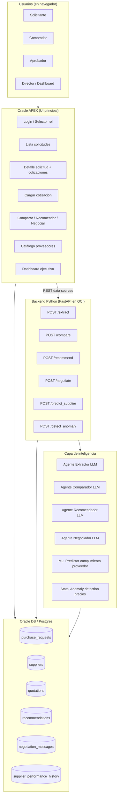

# ComprasPy: Copiloto Inteligente de Compras — Plan Ejecutable

> Plan completo de ejecución para el desafío oficial del Hackathon Oracle APEX + Agentes de IA. **Este es el único plan vinculante** — los specs anteriores (EpiPy, AgroPy, VendePy, etc.) NO aplican al desafío oficial y se mantienen solo como referencia histórica.

---

## 1. Resumen del proyecto

**ComprasPy** es un copiloto inteligente que asiste a un equipo de compras (solicitante, comprador, aprobador) durante el ciclo completo: registrar solicitud → cargar cotizaciones de proveedores → comparar normalizadamente → recibir recomendación justificada → generar mensaje de negociación.

La aplicación vive en **Oracle APEX** (UI principal) y consume un **backend Python con FastAPI + LangGraph** (agentes IA + ML predictivo) vía REST. Persistencia compartida en Oracle DB / Postgres.

**Cumple el desafío oficial al 100%:**
- ✅ App en Oracle APEX
- ✅ Registra solicitudes, proveedores, cotizaciones
- ✅ Compara automáticamente las ofertas
- ✅ Genera recomendación justificada
- ✅ Produce mensaje de negociación asistido por IA
- ✅ Multi-rol con flujo coherente

**Diferencial técnico:** integración de ML predictivo (predictor de cumplimiento de proveedor) que alimenta al agente recomendador, además de los 4 agentes LLM core. Esto cubre el criterio "Innovación y creatividad" (5% del puntaje del pitch) y refuerza "Calidad de la recomendación" (10%).

---

## 2. Arquitectura técnica



**Hosting:**
- APEX en `apex.oracle.com` (free tier) — workspace gratuito
- Backend Python en OCI Compute (free tier) o Cloud Run / Render como fallback
- DB compartida (la que viene con APEX)

---

## 3. Dónde vive la IA/ML — la pregunta clave

Tres capas distintas con propósitos distintos.

### 3.1 Capa LLM (4 agentes — esto es lo que evalúa explícitamente el brief)

#### Agente #1 — Extractor de cotizaciones

**Trigger:** comprador sube PDF, Excel, foto o pega texto de cotización.

**Input:** archivo crudo + contexto de la solicitud (qué se cotizó, qué items se esperan).

**Output estructurado (JSON):**
```json
{
  "supplier_info": {"legal_name": "...", "ruc": "...", "contact": "..."},
  "validity_days": 30,
  "currency": "PYG",
  "includes_iva": true,
  "includes_shipping": false,
  "payment_terms": "30 días contra entrega",
  "delivery_days": 15,
  "warranty_months": 12,
  "items": [
    {"description": "...", "quantity": 10, "unit_price_pyg": 120000, "subtotal_pyg": 1200000, "brand": "...", "model": "..."}
  ],
  "total_pyg": 12500000,
  "discount_pct": 5,
  "notes": "..."
}
```

**Mecánica:** Claude Sonnet o GPT-4o-mini con structured output (Pydantic schema). Si el archivo es PDF lo procesamos con `pypdf` para texto + visión del modelo si tiene tablas. Si es imagen, vision-capable model directo.

**Por qué es valor real:** hoy el comprador transcribe manualmente las cotizaciones a Excel. **Esto le ahorra 15-30 minutos por cotización.**

#### Agente #2 — Comparador normalizado

**Trigger:** comprador click "comparar" en la página de detalle de solicitud (≥2 cotizaciones cargadas).

**Input:** N cotizaciones extraídas estructuradas + criterios de evaluación de la solicitud.

**Output:** tabla normalizada lado a lado con:
- Items unificados (mismo SKU/concepto entre cotizaciones distintas)
- Precios normalizados (con IVA, con envío, en misma moneda)
- Plazos, garantías, condiciones de pago
- Diferencias destacadas (qué cotización ofrece qué)
- Total ajustado por proveedor

**Mecánica:** LLM con prompt que recibe las N cotizaciones y devuelve una matriz comparativa estructurada. Incluye lógica de matching de items (un proveedor escribe "Notebook Lenovo IdeaPad 3", otro escribe "Lenovo Ideapad-3 14 pulg", el LLM los mapea al mismo concepto).

**Por qué es valor real:** comparar 3-4 cotizaciones manualmente con condiciones distintas es 30-60 minutos. Acá son 5 segundos.

#### Agente #3 — Recomendador justificado

**Trigger:** comprador click "recomendar" después de ver comparación.

**Input:**
- Cotizaciones normalizadas (output del Agente #2)
- Criterios de evaluación + ponderación de la solicitud (precio 40%, plazo 30%, calidad 20%, condiciones 10% — configurable)
- **Predicción ML de cumplimiento por proveedor** (output del Modelo ML #1, descrito abajo)
- Score de anomalía por cotización (output del Modelo ML #2)

**Output:** recomendación en formato:
```markdown
## Recomendación: Proveedor B — TecnoSur SA

**Score compuesto: 87/100**

### Justificación
La cotización de TecnoSur SA destaca por...

### Comparativa por criterio
- **Precio (peso 40%):** USD 12,500. Es 8% superior al más barato (Proveedor C: USD 11,580) pero...
- **Plazo (peso 30%):** 7 días vs 15-21 días de alternativas. **Predicción ML: 91% probabilidad de cumplimiento** (basado en histórico de 23 entregas anteriores con 95% on-time)
- **Calidad/Garantía (peso 20%):** 24 meses vs 12 meses estándar
- **Condiciones (peso 10%):** Incluye envío e instalación

### Alternativas
- Proveedor C es 8% más barato pero ML predice solo 67% probabilidad de cumplir plazo dado sus últimas 3 entregas con retraso promedio de 6 días.
- Proveedor A tiene mejor garantía (36 meses) pero el plazo de 21 días supera la urgencia declarada (10 días).

### Riesgos identificados
- Cotización de Proveedor C tiene anomalía de precio: 22% por debajo del rango histórico para esta categoría — verificar especificaciones exactas para descartar diferencia de calidad oculta.

### Acción sugerida
Aprobar TecnoSur SA. Ver botón "Generar mensaje de negociación" para solicitar mejora de 5% en precio justificada por contraoferta de Proveedor C.
```

**Mecánica:** LLM grounding fuerte. El prompt incluye TODA la evidencia (cotizaciones, predicciones ML, criterios) y se pide razonamiento estructurado con citation a evidencia explícita.

**Por qué es valor real:** la justificación es lo que normalmente se pierde en cobranza/auditoría. Acá queda documentada y auditable.

#### Agente #4 — Generador de mensaje de negociación

**Trigger:** comprador click "generar mensaje de negociación" sobre una cotización seleccionada.

**Input:**
- Cotización seleccionada
- Mejor cotización alternativa (precio, plazo, condiciones)
- Brechas específicas que se quiere mejorar (precio, plazo, ambos)
- Tono solicitado (formal, cordial, asertivo)

**Output:** mensaje listo para enviar:
```text
Estimado equipo de TecnoSur,

Agradecemos la cotización [REF] recibida el 28/04/2026 para el suministro de
notebooks corporativos. Su propuesta es competitiva y valoramos especialmente
el plazo de entrega de 7 días.

Para avanzar con la adjudicación, nos sería muy útil revisar dos puntos:

1. Hemos recibido propuestas alternativas que se posicionan ~8% por debajo
   del precio cotizado. ¿Existe margen para acercar la oferta a este nivel
   manteniendo las especificaciones técnicas y la garantía propuesta?

2. ¿Es posible ampliar la garantía actual de 24 meses a 36 meses, considerando
   que esta es una compra para uso intensivo en oficina?

Quedamos atentos a su respuesta. La decisión de adjudicación se tomará el
viernes 02/05.

Cordialmente,
[Nombre del comprador]
[Empresa]
```

**Mecánica:** LLM con tono profesional paraguayo (formal pero no rígido). Permite editar antes de enviar. Opcional: integración con email/WhatsApp para enviar directo.

**Por qué es valor real:** los compradores junior tardan 20-30 min componiendo este tipo de mensaje. Senior lo hacen en 5 min pero con calidad inconsistente. **El LLM produce nivel senior en 10 segundos, consistentemente.**

### 3.2 Capa ML predictivo (diferenciador técnico, alimenta al Recomendador)

Esto es lo que distingue ComprasPy de un wrapper de LLMs. Es ML real con loop predict-action limpio.

#### Modelo #1 — Predictor de cumplimiento de proveedor

**Predice:**
- `p_on_time`: probabilidad de que el proveedor entregue dentro del plazo prometido
- `expected_delay_days`: días promedio de retraso si no cumple
- `p_price_holds`: probabilidad de que el precio cotizado se mantenga (sin "extras" sorpresa)

**Features:**
- Histórico del proveedor: % entregas a tiempo últimas 12, 6, 3 entregas
- Días promedio de retraso histórico
- Categoría del producto (algunos productos tienen mayor incertidumbre)
- Monto de la cotización (montos altos a veces se demoran más en logística)
- Plazo prometido (plazos muy cortos tienden a fallar más)
- Antigüedad del proveedor en cartera
- Ratio de cotizaciones aceptadas / presentadas

**Modelo:** XGBoost — uno de clasificación binaria (cumple/no cumple) y uno de regresión (días de retraso esperado dado que falla).

**Entrenamiento:** dataset sintético de ~500 entregas históricas distribuidas entre 8-12 proveedores demo. Calibración a benchmarks de procurement industry:
- Tasa promedio de cumplimiento on-time en LATAM: 65-78% según sector (citable)
- Distribución por proveedor: top quartile 90%+, mediano 70-80%, bottom quartile 40-60%

**Validación:** time-based split sobre el sintético. Reportar AUC + MAE de retraso.

**Output al sistema:**
```json
{
  "supplier_id": "uuid",
  "p_on_time": 0.91,
  "expected_delay_days_if_late": 3.2,
  "p_price_holds": 0.95,
  "confidence_band": "high",
  "based_on_n_observations": 23,
  "top_contributing_features": ["historical_on_time_rate", "category_consistency"]
}
```

**Cómo lo consume el sistema:**
- El **Agente Recomendador** recibe esto como feature
- En la UI APEX, cada proveedor en la comparación muestra una banda visual (verde/amarillo/rojo) de "confiabilidad histórica"
- En el catálogo de proveedores, hay un **Score Predictivo** que ranking todos los proveedores

**Por qué resuelve el critique de "ML decorativo":**
- Predice algo no trivial (cumplimiento futuro)
- Cambia decisión real (la recomendación pondera esto)
- Variance es real (proveedores buenos vs malos genuinamente difieren)
- Loop predict-action observable (cada compra tiene outcome)

#### Modelo #2 — Anomaly detection sobre precios

**Detecta:** cotizaciones con precios atípicos para una categoría.

**Mecánica:** Z-score sobre precios históricos por categoría de producto. Si un proveedor cotiza un notebook a Gs. 2.5M cuando el rango histórico es Gs. 4.5M-6M, **flag**.

**Posibles causas (que el sistema sugiere investigar):**
- Especificaciones diferentes (modelo distinto al solicitado)
- Error en cotización
- Producto remanufacturado
- Stock discontinuado en oferta
- Trampa (cebo bajo, recargos en factura)

**Output:** anomaly_score por cotización + razón sugerida + comparativa con rango histórico.

**Cómo lo consume el sistema:**
- El **Agente Recomendador** lo cita en la sección "Riesgos identificados"
- En la UI APEX, las cotizaciones con anomalía aparecen marcadas con un ⚠️ y tooltip explicativo

### 3.3 Capa estadística / heurística (complementaria)

**Score multicriterio compuesto:** weighted sum de los criterios definidos por la solicitud (precio, plazo, calidad, condiciones), cada uno normalizado, ajustado por el predictor ML de cumplimiento.

**Ranking de proveedores en catálogo:** ordenamiento por score histórico + ML predictivo + cobertura de categorías.

---

## 4. Stack técnico

| Capa | Tecnología |
|---|---|
| Frontend | **Oracle APEX 23+** (apex.oracle.com workspace gratuito) |
| Backend | Python 3.12, FastAPI, Pydantic |
| LLM orchestration | LangGraph |
| LLMs | Claude Sonnet 4.6 (agentes principales), Gemini 2.5 Flash (clasificadores rápidos) |
| LLM con visión (PDFs/imágenes) | Claude Sonnet 4.6 o GPT-4o |
| Embeddings | OpenAI text-embedding-3-small (para búsqueda semántica de proveedores) |
| ML | scikit-learn, XGBoost |
| DB | Oracle (la que viene con APEX) — alternativa Postgres si preferimos pgvector |
| Comunicación APEX↔Backend | REST Data Sources nativos APEX |
| Hosting backend | OCI Compute free tier (o Render/Cloud Run como Plan B) |
| Object storage (PDFs originales) | OCI Object Storage o S3 compatible |
| Tests | pytest |

---

## 5. Modelo de datos

```sql
-- Usuarios (mock auth con selector de rol)
CREATE TABLE users (
    id RAW(16) PRIMARY KEY,  -- en Postgres sería UUID
    name VARCHAR2(200),
    email VARCHAR2(200),
    role VARCHAR2(50),  -- 'solicitante', 'comprador', 'aprobador', 'director'
    department VARCHAR2(100),
    metadata CLOB  -- JSON
);

-- Proveedores
CREATE TABLE suppliers (
    id RAW(16) PRIMARY KEY,
    ruc VARCHAR2(20) UNIQUE,
    legal_name VARCHAR2(300),
    commercial_name VARCHAR2(300),
    contact_email VARCHAR2(200),
    contact_phone VARCHAR2(50),
    contact_person VARCHAR2(200),
    primary_categories VARCHAR2(500),
    onboarded_at DATE,
    embedding BLOB,  -- vector embedding para búsqueda semántica
    -- Performance histórica (denormalizada para velocidad)
    total_quotes_received NUMBER DEFAULT 0,
    total_awarded NUMBER DEFAULT 0,
    on_time_rate NUMBER(5,2),  -- 0-100
    avg_delay_days NUMBER(5,2),
    quality_score NUMBER(5,2),
    last_activity_at TIMESTAMP
);

-- Solicitudes de compra
CREATE TABLE purchase_requests (
    id RAW(16) PRIMARY KEY,
    requestor_id RAW(16) REFERENCES users(id),
    title VARCHAR2(300),
    description CLOB,
    category VARCHAR2(100),
    urgency VARCHAR2(20),  -- 'normal', 'urgente', 'crítica'
    budget_estimate_pyg NUMBER,
    criteria_weights CLOB,  -- JSON: {"price": 40, "delivery": 30, "quality": 20, "terms": 10}
    deadline_date DATE,
    status VARCHAR2(50),  -- 'draft', 'in_quoting', 'comparing', 'recommended', 'approved', 'closed'
    approver_id RAW(16) REFERENCES users(id),
    approved_at TIMESTAMP,
    awarded_quotation_id RAW(16),
    created_at TIMESTAMP DEFAULT CURRENT_TIMESTAMP,
    updated_at TIMESTAMP DEFAULT CURRENT_TIMESTAMP
);

-- Items dentro de la solicitud
CREATE TABLE request_items (
    id NUMBER GENERATED ALWAYS AS IDENTITY PRIMARY KEY,
    request_id RAW(16) REFERENCES purchase_requests(id),
    description VARCHAR2(500),
    quantity NUMBER,
    unit VARCHAR2(50),
    specifications CLOB,
    target_price_pyg NUMBER
);

-- Cotizaciones recibidas
CREATE TABLE quotations (
    id RAW(16) PRIMARY KEY,
    request_id RAW(16) REFERENCES purchase_requests(id),
    supplier_id RAW(16) REFERENCES suppliers(id),
    received_date DATE,
    validity_date DATE,
    total_pyg NUMBER,
    currency VARCHAR2(10) DEFAULT 'PYG',
    exchange_rate NUMBER(10,4),
    includes_iva NUMBER(1) DEFAULT 1,
    includes_shipping NUMBER(1) DEFAULT 0,
    payment_terms VARCHAR2(200),
    delivery_days NUMBER,
    warranty_months NUMBER,
    discount_pct NUMBER(5,2),
    notes CLOB,
    raw_file_url VARCHAR2(500),  -- referencia a PDF/Excel original
    raw_extracted_text CLOB,  -- texto crudo extraído
    extraction_confidence NUMBER(3,2),  -- 0-1
    anomaly_score NUMBER(3,2),  -- 0-1, viene del modelo de anomaly detection
    anomaly_reason VARCHAR2(500),
    status VARCHAR2(50) DEFAULT 'received',  -- 'received', 'normalized', 'compared', 'awarded', 'rejected'
    created_at TIMESTAMP DEFAULT CURRENT_TIMESTAMP
);

-- Items dentro de la cotización
CREATE TABLE quotation_items (
    id NUMBER GENERATED ALWAYS AS IDENTITY PRIMARY KEY,
    quotation_id RAW(16) REFERENCES quotations(id),
    request_item_id NUMBER REFERENCES request_items(id),
    description VARCHAR2(500),
    quantity NUMBER,
    unit_price_pyg NUMBER,
    subtotal_pyg NUMBER,
    discount_pct NUMBER(5,2),
    brand VARCHAR2(100),
    model VARCHAR2(100),
    lead_time_days NUMBER,
    notes VARCHAR2(500)
);

-- Recomendaciones generadas por el agente
CREATE TABLE recommendations (
    id RAW(16) PRIMARY KEY,
    request_id RAW(16) REFERENCES purchase_requests(id),
    recommended_quotation_id RAW(16) REFERENCES quotations(id),
    composite_score NUMBER(5,2),
    criteria_scores CLOB,  -- JSON: scores por criterio
    reasoning_markdown CLOB,
    alternatives_considered CLOB,  -- JSON: array de quotation_ids con sus scores
    risks_identified CLOB,
    model_version VARCHAR2(50),
    generated_at TIMESTAMP DEFAULT CURRENT_TIMESTAMP,
    accepted_at TIMESTAMP,
    accepted_by RAW(16) REFERENCES users(id),
    decision_outcome VARCHAR2(50)  -- 'accepted', 'modified', 'rejected'
);

-- Mensajes de negociación generados
CREATE TABLE negotiation_messages (
    id RAW(16) PRIMARY KEY,
    quotation_id RAW(16) REFERENCES quotations(id),
    request_id RAW(16) REFERENCES purchase_requests(id),
    target_improvements CLOB,  -- JSON: {"price": -5, "delivery": -3, "warranty": +12}
    tone VARCHAR2(50),
    message_text CLOB,
    generated_at TIMESTAMP DEFAULT CURRENT_TIMESTAMP,
    sent_at TIMESTAMP,
    sent_via VARCHAR2(50),  -- 'email', 'whatsapp', 'manual'
    response_received_at TIMESTAMP,
    response_text CLOB
);

-- Histórico de performance de proveedores (para entrenar ML)
CREATE TABLE supplier_performance_history (
    id NUMBER GENERATED ALWAYS AS IDENTITY PRIMARY KEY,
    supplier_id RAW(16) REFERENCES suppliers(id),
    quotation_id RAW(16) REFERENCES quotations(id),
    awarded_date DATE,
    promised_delivery_date DATE,
    actual_delivery_date DATE,
    delivered_on_time NUMBER(1),
    days_delay NUMBER,
    price_at_award NUMBER,
    price_actual NUMBER,
    quality_score NUMBER(3,2),
    category VARCHAR2(100),
    notes VARCHAR2(500)
);

-- Predicciones cacheadas del modelo ML
CREATE TABLE supplier_predictions (
    supplier_id RAW(16) PRIMARY KEY REFERENCES suppliers(id),
    p_on_time NUMBER(3,2),
    expected_delay_days NUMBER(5,2),
    p_price_holds NUMBER(3,2),
    confidence_band VARCHAR2(20),
    based_on_n_observations NUMBER,
    top_features CLOB,
    model_version VARCHAR2(50),
    computed_at TIMESTAMP DEFAULT CURRENT_TIMESTAMP
);

-- Eventos / audit log
CREATE TABLE events (
    id NUMBER GENERATED ALWAYS AS IDENTITY PRIMARY KEY,
    event_type VARCHAR2(100),
    actor_id RAW(16),
    resource_type VARCHAR2(50),
    resource_id RAW(16),
    payload CLOB,
    occurred_at TIMESTAMP DEFAULT CURRENT_TIMESTAMP
);

-- Knowledge base (RAG sobre políticas de compra, normativa interna, etc.)
CREATE TABLE kb_chunks (
    id NUMBER GENERATED ALWAYS AS IDENTITY PRIMARY KEY,
    namespace VARCHAR2(100),
    chunk CLOB,
    embedding BLOB,
    source VARCHAR2(200),
    metadata CLOB
);
```

---

## 6. Páginas APEX (6 páginas core)

### Página 1 — Login / Selector de rol mock

**Propósito:** simulación de auth para el demo. Selector de 4 roles.

**Componentes:**
- Logo + título
- 4 botones grandes: Solicitante, Comprador, Aprobador, Director
- Cada botón setea Application Items `G_USER_ID` y `G_ROLE` y redirige a Página 2

**Tiempo estimado de construcción:** 15 min.

### Página 2 — Lista de solicitudes (Inbox)

**Propósito:** vista principal del usuario. Muestra solicitudes según su rol.

**Componentes:**
- **Header bar** con rol activo + botón de cambio
- **Cards o Interactive Report** con solicitudes filtradas:
  - Solicitante: ve solo las propias
  - Comprador: ve todas las que están en estado `in_quoting`, `comparing`, `recommended`
  - Aprobador: ve solo `recommended` que necesitan aprobación
  - Director: ve todas con KPIs agregados
- **Filtros laterales:** estado, urgencia, fecha, categoría
- **Botón "Nueva solicitud"** (visible solo a solicitante)
- **Stats cards arriba:** "5 solicitudes activas", "2 esperando cotizaciones", "1 lista para aprobar"

**Tiempo estimado:** 40 min.

### Página 3 — Crear / Editar solicitud

**Propósito:** form para registrar nueva solicitud.

**Componentes:**
- Form con campos:
  - Título
  - Descripción (textarea)
  - Categoría (select con catálogo)
  - Urgencia (radio: normal / urgente / crítica)
  - Presupuesto estimado
  - Fecha límite de respuesta
  - **Pesos de criterios** (4 sliders: precio, plazo, calidad, condiciones — suma 100)
- **Sub-region: Items de la solicitud** (master-detail)
  - Tabla editable: descripción, cantidad, unidad, especificaciones, precio target
- Botón "Guardar borrador" + "Publicar solicitud"

**Al publicar:** estado pasa a `in_quoting`, se notifica al comprador.

**Tiempo estimado:** 35 min.

### Página 4 — Detalle de solicitud + cotizaciones recibidas

**Propósito:** página central del workflow. Comprador ve la solicitud y carga cotizaciones.

**Componentes:**
- **Region 1: Resumen de la solicitud** (read-only, datos de la página 3)
- **Region 2: Cotizaciones cargadas** (Interactive Report)
  - Columnas: Proveedor, Total, Plazo, Garantía, Anomaly score (icono), Confianza ML (banda color), Acciones
  - Botón "Cargar cotización" arriba
- **Region 3: Acciones globales**
  - Botón **"Comparar cotizaciones"** (activa cuando hay ≥2)
  - Botón **"Generar recomendación"** (activa después de comparar)

**Tiempo estimado:** 50 min.

### Página 5 — Cargar cotización

**Propósito:** modal o página donde el comprador sube una cotización y el LLM la extrae.

**Componentes:**
- Selector de proveedor (existente o nuevo)
- File upload (PDF, Excel, imagen) **+ alternativa: textarea para pegar texto**
- Botón "Procesar con IA"
- **Loading state** mientras LLM procesa
- **Resultado:** preview de la extracción estructurada — campos editables para corregir errores del LLM
- Botón "Confirmar y guardar"

**Backend call:** `POST /api/extract` con file_url o texto.

**Tiempo estimado:** 50 min.

### Página 6 — Comparar / Recomendar / Negociar (la página estrella)

**Propósito:** la página donde se demuestra todo el valor de la IA.

**Componentes:**
- **Region 1: Tabla comparativa normalizada** (output del Agente Comparador)
  - Header con cada proveedor en columna
  - Filas: items, precio total, plazo, garantía, condiciones, ML score
  - Highlights: mejor precio en verde, mejor plazo en azul, etc.
  - Anomalías marcadas con ⚠️
- **Region 2: Recomendación generada** (output del Agente Recomendador)
  - Markdown rendered: justificación, scores por criterio, alternativas, riesgos
  - Botón "Ajustar criterios" (re-corre el recomendador con nuevos pesos)
  - Botón "Aceptar recomendación" (cambia estado, notifica aprobador)
- **Region 3: Generador de mensaje de negociación**
  - Selector de proveedor (default: el recomendado)
  - Inputs: qué quiere mejorar (precio, plazo, garantía), tono (formal/cordial/asertivo)
  - Botón "Generar mensaje"
  - Display del mensaje generado (editable)
  - Botón "Copiar al portapapeles" / "Enviar por email" (mock)

**Backend calls:** `/api/compare`, `/api/recommend`, `/api/negotiate`.

**Tiempo estimado:** 1 hora.

### Página 7 — Catálogo de proveedores (opcional si tiempo permite)

**Propósito:** listado de proveedores con sus scores ML predictivos.

**Componentes:**
- Cards o Interactive Report
- Por proveedor: nombre, categorías, P(cumple plazo) ML score, on-time rate histórico, # cotizaciones, # adjudicaciones
- Drill-down a histórico

**Tiempo estimado:** 30 min.

### Página 8 — Dashboard ejecutivo (Director)

**Propósito:** vista del Director con KPIs.

**Componentes:**
- KPI cards: solicitudes este mes, monto total comprado, ahorro vs presupuesto, tiempo promedio de cierre
- Chart: evolución mensual de gasto
- Chart: gasto por categoría (pie)
- Top 5 proveedores adjudicados
- Top 5 proveedores con mejor ML score
- Anomalías detectadas

**Tiempo estimado:** 30 min.

---

## 7. Backend Python: endpoints + prompts

### Estructura del proyecto

```
compras-backend/
├── pyproject.toml
├── .env.example
├── README.md
├── src/
│   ├── main.py                # FastAPI app
│   ├── config.py
│   ├── deps.py
│   ├── routers/
│   │   ├── extract.py
│   │   ├── compare.py
│   │   ├── recommend.py
│   │   ├── negotiate.py
│   │   └── ml.py
│   ├── agents/
│   │   ├── extractor.py       # LLM agent #1
│   │   ├── comparator.py      # LLM agent #2
│   │   ├── recommender.py     # LLM agent #3
│   │   └── negotiator.py      # LLM agent #4
│   ├── ml/
│   │   ├── supplier_predictor.py   # ML model #1
│   │   ├── anomaly_detector.py     # ML model #2
│   │   └── train.py
│   ├── models.py              # Pydantic schemas
│   ├── db.py                  # DB connection
│   └── prompts/
│       ├── extractor.txt
│       ├── comparator.txt
│       ├── recommender.txt
│       └── negotiator.txt
├── fixtures/
│   ├── sample_quotations/     # PDFs de ejemplo
│   ├── suppliers.csv
│   ├── historical_performance.csv
│   └── seed_db.py
└── tests/
    └── test_agents.py
```

### Endpoint #1: POST /extract

```python
@router.post("/extract")
async def extract_quotation(
    file: UploadFile,
    request_id: str,
    supplier_hint: str | None = None
) -> QuotationStructured:
    # 1. Procesar archivo (PDF → texto, imagen → vision)
    if file.content_type == "application/pdf":
        text = extract_pdf_text(file)
        if low_text_volume(text):  # PDF con tablas que no parsean bien
            text = vision_extract(file)
    elif file.content_type.startswith("image/"):
        text = vision_extract(file)
    else:
        text = file.read().decode("utf-8")
    
    # 2. Recuperar contexto de la solicitud
    request_context = db.get_request_context(request_id)
    
    # 3. LLM con structured output
    extraction = await extractor_agent.invoke({
        "raw_text": text,
        "request_context": request_context,
        "supplier_hint": supplier_hint
    })
    
    # 4. Validar y enriquecer
    extraction = validate_extraction(extraction)
    
    # 5. Persistir + return
    quotation_id = db.save_quotation(extraction)
    
    # 6. Trigger anomaly detection async
    enqueue_anomaly_check(quotation_id)
    
    return extraction
```

**Prompt del Agente Extractor:**

```
Sos un asistente de procurement experto en extraer información estructurada de cotizaciones de proveedores paraguayos.

CONTEXTO DE LA SOLICITUD:
{request_context}

TEXTO DE LA COTIZACIÓN:
{raw_text}

INSTRUCCIONES:
1. Extraé toda la información disponible en formato JSON estricto siguiendo el schema definido.
2. Si un campo no está presente en el texto, devolvé null. NO INVENTES.
3. Para precios, normalizá el formato a número entero en guaraníes (PYG).
4. Detectá si los precios incluyen IVA. Si dice "más IVA" o no menciona, asumí que NO incluye.
5. Detectá la moneda original. Si está en USD, marcalo. NO conviertas — solo registrá la moneda y el monto original.
6. Para el plazo de entrega, extraé días hábiles si lo especifica, sino días corridos.
7. Mapeá cada item de la cotización al item correspondiente de la solicitud cuando sea posible (matching semántico).
8. Reportá tu confianza global (0.0-1.0) en la calidad de la extracción.

DEVOLVÉ JSON SIGUIENDO ESTE SCHEMA:
{schema_pydantic}
```

### Endpoint #2: POST /compare

```python
@router.post("/compare")
async def compare_quotations(
    request_id: str
) -> ComparisonResult:
    quotations = db.get_quotations_for_request(request_id)
    request = db.get_request(request_id)
    
    if len(quotations) < 2:
        raise HTTPException(400, "Se necesitan al menos 2 cotizaciones para comparar")
    
    # Llamar al comparador LLM
    comparison = await comparator_agent.invoke({
        "request": request,
        "quotations": quotations
    })
    
    return comparison
```

**Prompt del Agente Comparador:**

```
Sos un analista de compras que normaliza cotizaciones para comparación objetiva.

SOLICITUD ORIGINAL:
{request}

COTIZACIONES RECIBIDAS:
{quotations}

INSTRUCCIONES:
1. Para cada item de la solicitud, identificá las cotizaciones que lo cubren.
2. Si dos proveedores describen el mismo producto con distinto wording, mapealos al mismo concepto.
3. Normalizá precios:
   - Llevá todo a PYG (con IVA incluido) usando tipo de cambio del día si hay USD.
   - Si una cotización no incluye IVA, agregale 10%.
   - Si no incluye envío, agregá estimación de Gs. 200K si es Asunción metropolitana.
4. Producí una tabla comparativa con:
   - Total normalizado por proveedor
   - Plazo en días corridos
   - Garantía en meses
   - Forma de pago estandarizada
5. Identificá diferencias significativas (>10% en precio, >50% en plazo, etc.)
6. Reportá QUE proveedor ofrece mejor en cada criterio.

DEVOLVÉ JSON ESTRICTO:
{
  "items_normalized": [...],
  "totals_by_supplier": [{...}],
  "best_in_criterion": {"price": "supplier_id", "delivery": "supplier_id", ...},
  "significant_differences": [...]
}
```

### Endpoint #3: POST /recommend

```python
@router.post("/recommend")
async def generate_recommendation(
    request_id: str,
    custom_weights: dict | None = None
) -> Recommendation:
    request = db.get_request(request_id)
    quotations = db.get_quotations_for_request(request_id)
    comparison = await compare_quotations(request_id)
    
    # Cargar predicciones ML para cada proveedor involucrado
    ml_predictions = {
        q.supplier_id: ml.get_supplier_prediction(q.supplier_id)
        for q in quotations
    }
    
    # Cargar anomaly scores
    anomalies = {
        q.id: ml.get_quotation_anomaly(q.id)
        for q in quotations
    }
    
    weights = custom_weights or request.criteria_weights
    
    # Llamar al recomendador LLM con TODA la evidencia
    recommendation = await recommender_agent.invoke({
        "request": request,
        "comparison": comparison,
        "ml_predictions": ml_predictions,
        "anomalies": anomalies,
        "weights": weights
    })
    
    db.save_recommendation(recommendation)
    return recommendation
```

**Prompt del Agente Recomendador:** (resumido — el real es más extenso)

```
Sos un asistente senior de compras que genera recomendaciones JUSTIFICADAS Y AUDITABLES.

EVIDENCIA DISPONIBLE:
- Solicitud: {request}
- Comparación normalizada: {comparison}
- Predicciones ML de cumplimiento por proveedor: {ml_predictions}
- Anomalías detectadas en cotizaciones: {anomalies}
- Pesos de criterios: {weights}

INSTRUCCIONES:
1. Calculá un score compuesto por cotización combinando:
   - Score de precio (normalizado al rango de las cotizaciones)
   - Score de plazo (similar)
   - Score de calidad (garantía, marca, especificaciones)
   - Score de condiciones (forma de pago, soporte)
   - **AJUSTE por p_on_time del modelo ML** (penalizar proveedores con baja probabilidad de cumplimiento)
   - **PENALIZACIÓN por anomalía de precio** (cotizaciones con score > 0.7 reciben warning)
2. Recomendá UNA cotización con su score compuesto.
3. Justificá la recomendación citando evidencia explícita.
4. Mencioná las alternativas y por qué se descartaron.
5. Identificá riesgos (anomalías, baja confianza ML, plazos ajustados, etc.).
6. Sugerí acciones concretas (aceptar, negociar específicamente, rechazar).

REGLA CRÍTICA: NO INVENTES NÚMEROS. Solo cita evidencia que está en los inputs.

DEVOLVÉ MARKDOWN siguiendo este formato:
## Recomendación: [Proveedor X]
**Score compuesto: NN/100**

### Justificación
...

### Comparativa por criterio
- **Precio (peso N%):** ...
- **Plazo (peso N%):** ...
...

### Alternativas
...

### Riesgos identificados
...

### Acción sugerida
...
```

### Endpoint #4: POST /negotiate

```python
@router.post("/negotiate")
async def generate_negotiation_message(
    quotation_id: str,
    target_improvements: dict,  # {"price_pct": -5, "delivery_days": -3}
    tone: str = "cordial"
) -> NegotiationMessage:
    quotation = db.get_quotation(quotation_id)
    request = db.get_request(quotation.request_id)
    other_quotations = db.get_other_quotations(quotation.request_id, quotation_id)
    best_alternative = pick_best_alternative(other_quotations, target_improvements)
    
    message = await negotiator_agent.invoke({
        "quotation": quotation,
        "request": request,
        "best_alternative": best_alternative,
        "target_improvements": target_improvements,
        "tone": tone
    })
    
    db.save_negotiation_message(message)
    return message
```

**Prompt del Agente Negociador:**

```
Sos un comprador profesional paraguayo experimentado en negociar con proveedores.

CONTEXTO:
- Cotización del proveedor a negociar: {quotation}
- Mejor alternativa disponible (sin nombrar al competidor): {best_alternative}
- Mejoras solicitadas: {target_improvements}
- Tono solicitado: {tone}

INSTRUCCIONES:
1. Generá un email profesional al proveedor pidiendo las mejoras solicitadas.
2. NO menciones el nombre del competidor — solo "ofertas alternativas" o "propuestas competitivas recibidas".
3. Si pedís rebaja de precio, justificá con la diferencia % vs alternativas.
4. Si pedís mejor plazo, mencioná la urgencia de la solicitud.
5. Tono "cordial": amable pero directo. "Formal": más distante. "Asertivo": claro sobre límites.
6. Mantené el mensaje en 200-300 palabras máximo.
7. Incluí cierre con plazo claro para responder.

DEVOLVÉ TEXTO PLANO listo para enviar por email.
```

### Endpoint #5: POST /predict_supplier

```python
@router.post("/predict_supplier/{supplier_id}")
async def predict_supplier_performance(supplier_id: str):
    """Inferencia del modelo ML #1."""
    features = ml.build_supplier_features(supplier_id)
    prediction = ml.supplier_predictor.predict(features)
    db.cache_prediction(supplier_id, prediction)
    return prediction
```

### Endpoint #6: POST /detect_anomaly

```python
@router.post("/detect_anomaly")
async def detect_quotation_anomaly(quotation_id: str):
    """Anomaly detection sobre la cotización."""
    quotation = db.get_quotation(quotation_id)
    historical_prices = db.get_historical_prices_for_category(quotation.category)
    z_scores = ml.compute_anomaly(quotation.items, historical_prices)
    overall_score = max(z_scores)
    reason = ml.diagnose_anomaly(quotation, z_scores)
    db.save_anomaly(quotation_id, overall_score, reason)
    return {"anomaly_score": overall_score, "reason": reason}
```

---

## 8. Pre-trabajo crítico (antes del evento)

Sin esto el plan de 8h no cierra. **Hacer en los días previos.**

### PT-1: Cuenta APEX gratuita y workspace setup

- Crear cuenta en https://apex.oracle.com
- Solicitar workspace (instantáneo)
- Confirmar acceso al SQL Workshop
- Crear las tablas del modelo de datos (sección 5)
- Verificar que se pueden crear páginas

**Tiempo:** 30-45 min.

### PT-2: Cuenta de OpenAI / Anthropic con créditos

- Cuenta Anthropic (Claude) con créditos suficientes (~USD 10 alcanzan para todo el demo)
- API key configurada y testeada con curl
- Alternativa: cuenta OpenAI con GPT-4o-mini

**Tiempo:** 15 min.

### PT-3: Backend Python skeleton

Crear el repo con la estructura de la sección 7. Stubs de los 4 agentes (no implementados todavía, solo signatures + docstrings + return mock data).

```bash
mkdir compras-backend && cd compras-backend
poetry init
poetry add fastapi uvicorn pydantic python-dotenv anthropic openai langgraph xgboost scikit-learn pandas
```

Hacer un `main.py` que arranque y un endpoint dummy `/health`. Subirlo a OCI Compute (free tier) o Render para tener URL pública lista.

**Tiempo:** 1-1.5 horas.

### PT-4: Fixtures de datos

#### PT-4.1: 8-12 proveedores demo

Lista de proveedores con datos de Paraguay realistas (mezcla de empresas reales conocidas + sintéticos):
- TecnoSur SA (electrónica)
- Distribuidora Iturbe SRL (consumo masivo)
- Suministros Asunción (oficina)
- Importadora del Este (variedad)
- Compañía Paraguaya de Distribución (varios)
- ComputerWorld (IT)
- Mueblería Central
- Industrial del Paraguay
- Servitec (servicios)
- Logística Norte
- ProTec Soluciones
- DataPlus

Cada uno con: RUC sintético, dirección, contacto, categorías cubiertas, embeddings.

Output: `fixtures/suppliers.csv` con 12 filas.

**Tiempo:** 30 min.

#### PT-4.2: Histórico de performance sintético

Script Python que genera ~500 entregas históricas distribuidas entre los 12 proveedores con calibración:
- 3 proveedores top quartile (90%+ on-time)
- 5 proveedores mid quartile (70-85%)
- 4 proveedores bottom quartile (45-65%)
- Distribución realista de delays (right-skewed)
- Variation across categories

Output: `fixtures/supplier_performance_history.csv`.

**Tiempo:** 1 hora.

#### PT-4.3: 10-15 solicitudes demo + 30-40 cotizaciones

Crear solicitudes variadas:
- "Compra de 20 notebooks para área administrativa" — categoría: IT
- "Servicio de catering para evento corporativo" — categoría: Servicios
- "Suministros de oficina trimestral" — categoría: Oficina
- "Renovación de mobiliario sala de reuniones" — categoría: Mobiliario
- ... etc

Para cada solicitud, 2-4 cotizaciones de proveedores distintos con diferencias realistas.

Algunas con anomalías deliberadas (precio fuera de rango) para mostrar la detección.

Output: `fixtures/requests.csv` + `fixtures/quotations.csv`.

**Tiempo:** 1.5 horas.

#### PT-4.4: Plantillas de cotizaciones reales (PDFs y Excels)

Para el demo del agente extractor, necesitamos **plantillas de cotizaciones reales** de 3-5 proveedores paraguayos:
- 1 PDF "lindo" (formato profesional con logo, tabla de items)
- 1 PDF "feo" (escaneo, formato tabla rota)
- 1 Excel con headers raros
- 1 imagen (foto de cotización en papel)
- 1 texto pegado (típico WhatsApp del proveedor)

Esto NO es para usar datos reales — es para tener archivos con formatos realistas para que el LLM extractor los procese durante el demo.

**Cómo conseguirlos:** plantillas genéricas + datos sintéticos. Descargar templates de Excel y modificar.

Output: `fixtures/sample_quotations/`.

**Tiempo:** 1 hora.

### PT-5: Modelo ML pre-entrenado

Entrenar el supplier_predictor con `supplier_performance_history.csv`. Persistir el modelo serializado.

```python
# train.py
import xgboost as xgb
from sklearn.model_selection import train_test_split
import joblib

# Load fixtures
df = pd.read_csv("fixtures/supplier_performance_history.csv")
X, y = build_features(df), df["delivered_on_time"]
X_train, X_test, y_train, y_test = train_test_split(X, y, test_size=0.2)

model = xgb.XGBClassifier(n_estimators=100, max_depth=4, learning_rate=0.1)
model.fit(X_train, y_train)

print(f"AUC: {roc_auc_score(y_test, model.predict_proba(X_test)[:,1])}")
joblib.dump(model, "ml_models/supplier_predictor.pkl")
```

Lo mismo para anomaly detector (más simple — Z-scores precomputados por categoría).

Output: `ml_models/*.pkl` + métricas reportadas en `eval/results.md`.

**Tiempo:** 1.5 horas.

### PT-6: REST Data Sources de APEX

En APEX, configurar las **REST Data Sources** apuntando al backend Python desplegado:
- `EXTRACT_API` → `POST {backend_url}/api/extract`
- `COMPARE_API` → `POST {backend_url}/api/compare`
- `RECOMMEND_API` → `POST {backend_url}/api/recommend`
- `NEGOTIATE_API` → `POST {backend_url}/api/negotiate`
- `PREDICT_SUPPLIER_API` → `POST {backend_url}/api/predict_supplier/:supplier_id`

Probar cada una con datos dummy desde el SQL Workshop.

**Tiempo:** 45 min.

### PT-7: Tests sanity check

Verificar end-to-end:
1. APEX puede insertar/leer en sus tablas ✓
2. Backend responde a `/health` ✓
3. Backend acepta llamadas con auth header ✓
4. APEX REST Data Source devuelve JSON correcto ✓
5. Agente extractor procesa un PDF de muestra correctamente ✓

**Tiempo:** 30 min.

### Resumen pre-trabajo

| Tarea | Tiempo | Crítico |
|---|---|---|
| PT-1: APEX setup + tablas | 45 min | ✅ |
| PT-2: API keys LLM | 15 min | ✅ |
| PT-3: Backend skeleton + deploy | 1.5 h | ✅ |
| PT-4: Fixtures (proveedores + histórico + solicitudes + cotizaciones + PDFs) | 4 h | ✅ |
| PT-5: ML pre-entrenado | 1.5 h | ✅ |
| PT-6: REST Data Sources APEX | 45 min | ✅ |
| PT-7: Tests sanity check | 30 min | ✅ |
| **TOTAL** | **~9 horas** | |

⚠️ **El pre-trabajo es sustancial.** Hacé esto distribuido en 2-3 sesiones la noche antes y la mañana del evento.

Si solo tenés 4 horas: priorizar PT-1, PT-2, PT-3 skeleton, PT-4.1 + 4.3 + 4.4, PT-6. Posponer PT-5 (ML) al evento mismo (entrenar en hora 5-6 del evento).

---

## 9. Plan hora-por-hora del día del evento

| Hora | Hito | Notas |
|---|---|---|
| **0:00-0:30** | Verificar setup + cargar fixtures finales en DB | Si pre-trabajo completo, esto es solo confirmación |
| **0:30-1:30** | APEX: Página 1 (login mock) + Página 2 (lista solicitudes) | Páginas básicas, structures Universal Theme defaults |
| **1:30-2:30** | APEX: Página 3 (crear solicitud) + Página 4 (detalle solicitud + lista cotizaciones) | Master-detail |
| **2:30-3:30** | Backend: implementar agente extractor + endpoint `/extract` con prompt afinado | Probar con los 5 PDFs de fixture |
| **3:30-4:30** | APEX: Página 5 (cargar cotización) integrada con extractor | File upload + REST call + visualización |
| **4:30-5:30** | Backend: agentes comparador + recomendador + endpoints | Prompts afinados, structured output |
| **5:30-6:30** | APEX: Página 6 (comparar/recomendar/negociar) integrada | La página estrella del demo |
| **6:30-7:00** | Backend: agente negociador + ML predictor + endpoints | Negotiator es rápido, ML ya pre-entrenado |
| **7:00-7:30** | APEX: Página 7 (catálogo proveedores con ML scores) + Página 8 (dashboard ejecutivo) | Si tiempo, sino skipear página 7 |
| **7:30-7:50** | README + ADRs + eval suite + smoke test end-to-end | Demo prep |
| **7:50-8:00** | Buffer / fix de última hora / ensayo del pitch | |

**Reglas de oro:**
1. **APEX es load-bearing del 60%.** No skipear páginas centrales. Si algo no llega, sacrificá página 7 antes que páginas 4-6.
2. **El demo es de la página 6.** Asegurate que ESA página funcione perfecto, aunque tenga datos hardcodeados como fallback.
3. **Cada hito tiene salida funcional.** Si el agente recomendador falla en hora 5, el comparador anterior sigue siendo demoable.
4. **Tests aunque sean pocos.** 3-5 tests críticos visibles en el repo. Suma con el juez IA.
5. **README con badges + diagrama Mermaid + ADRs en `docs/adr/`.** Puntos fáciles para juez IA.

---

## 10. Demo arc (90 segundos)

```
[0:00] "Procesos de compra empresariales pierden 4-8 horas semanales 
        en transcribir cotizaciones, comparar manualmente, justificar 
        decisiones y redactar negociaciones. ComprasPy automatiza el 
        ciclo completo con agentes de IA."

[0:08] (APEX) Login como 'Comprador'. Página 2: 5 solicitudes 
        activas. Click en 'Compra de 20 notebooks'.

[0:18] Página 4: solicitud abierta, 3 cotizaciones recibidas 
        de TecnoSur, ComputerWorld, Suministros Asunción.
        Click en 'Cargar cotización' para sumar una cuarta.

[0:30] Página 5: arrastra el PDF de DataPlus. Click 'Procesar con IA'.
        Loading 4 segundos. Sistema muestra extracción estructurada:
        18 items, total Gs. 142M, plazo 14 días, garantía 24m.
        Comprador confirma con un click.

[0:50] Vuelta a Página 4. Ahora 4 cotizaciones. Click 'Comparar'.

[0:58] Página 6: tabla normalizada lado a lado. ComputerWorld 
        más barato (-12%) pero plazo 21 días. TecnoSur el balance.
        DataPlus marcado con ⚠️ anomalía: precio 35% bajo el rango.
        ML score por proveedor visible: TecnoSur 91%, DataPlus 58%.

[1:15] Click 'Generar recomendación'. 3 segundos. 
        Recomendación: TecnoSur. Score 87/100.
        Markdown explica: precio competitivo, ML predice 91% 
        cumplimiento, garantía superior. Cita evidencia.
        Riesgo identificado: anomalía DataPlus, sugerir verificar 
        especificaciones.

[1:30] Click 'Generar mensaje de negociación' a TecnoSur. 
        Pide -5% precio + reducir plazo a 5 días.
        Sistema genera email profesional 250 palabras citando 
        ofertas alternativas competitivas. Comprador edita una 
        línea, copia, lista para enviar.

[1:45] Cambio rol 'Director'. Dashboard ejecutivo: 
        Gs. 1.250M comprado este mes, 18% ahorro vs presupuesto, 
        cycle time promedio 3.2 días vs 5.1 anterior.

[1:55] 'APEX como UI principal de los 4 roles. Backend Python 
        con 4 agentes LLM y 1 modelo ML predictivo entrenado. 
        Datos sintéticos calibrados a benchmarks del sector.'
```

---

## 11. Cobertura de criterios oficiales

### Etapa 1: Aplicación APEX (60%)

| Criterio | Peso | Cómo lo cubrimos |
|---|---|---|
| **Funcionalidad principal** | 15% | Las 6 páginas core implementan el flujo completo: registrar → cotizar → comparar → recomendar → negociar |
| **Integración agentes IA** | 15% | 4 agentes LLM con propósitos distintos, integrados vía REST en cada página relevante |
| **Calidad recomendación** | 10% | Multicriterio (4 dimensiones configurables) + ML score + anomaly detection + citation a evidencia |
| **Diseño visual** | 10% | Universal Theme APEX + cards + interactive reports + modals + chart en dashboard |
| **Usabilidad** | 10% | Flujo lineal claro: lista → detalle → cargar → comparar → recomendar → negociar. Multi-rol con vistas adecuadas. |

### Etapa 2: Pitch (40%)

| Criterio | Peso | Cómo lo cubrimos |
|---|---|---|
| **Pertinencia** | 10% | El demo arc va directo al desafío del brief: tiempo + claridad + decisión informada |
| **Claridad pitch** | 10% | 90 segundos estructurados con 4-5 momentos visualmente distintos |
| **Innovación** | 5% | Diferencial: ML predictivo de cumplimiento de proveedor alimentando al recomendador (NO es un wrapper LLM puro) |
| **Factibilidad** | 10% | Arquitectura escalable: APEX para UI + backend Python + ML stack estándar. Roadmap claro post-hackaton. |
| **Impacto** | 5% | Beneficios cuantificados: ahorro de horas/semana, mejora % en cycle time, ahorro %% en compras adjudicadas, trazabilidad auditable. |

---

## 12. Riesgos y mitigaciones

### Riesgo R1: Backend Python no desplegado a tiempo

**Mitigación:** mock endpoints en APEX que devuelven JSON hardcoded de fixtures. El demo sigue funcionando, perdemos solo el "live" del extractor pero la UI muestra los outputs igual.

### Riesgo R2: Agente extractor falla con un PDF específico

**Mitigación:** tener 5 PDFs de fixture pre-procesados con outputs cacheados. Si el live falla, fallback a output cacheado.

### Riesgo R3: APEX REST Data Sources no se conectan correctamente

**Mitigación:** alternativa en PL/SQL con `apex_web_service.make_rest_request`. Más engorroso pero garantiza la conectividad.

### Riesgo R4: Tiempo de inferencia de Claude > 10 segundos en demo

**Mitigación:**
- Usar Claude Haiku 4.5 para velocidad en agentes simples
- Usar Claude Sonnet solo para Recomendador
- Pre-calentar el modelo con call dummy 30s antes del demo
- Loading states con mensajes amigables ("Analizando con IA...")

### Riesgo R5: Modelo ML predictor entrega scores absurdos

**Mitigación:**
- Validar antes del demo con test cases conocidos
- Fallback: si el modelo devuelve algo raro, usar tasa histórica simple (on-time rate)
- Reportar honestamente: "el modelo se entrenó con datos sintéticos calibrados; en producción se re-entrena con datos reales"

### Riesgo R6: Demo en vivo se traba por conectividad

**Mitigación:**
- Tener video de respaldo del demo grabado
- Tener todas las páginas pre-cargadas en pestañas
- Datos de demo persistidos en DB (no genera nada en vivo)

### Riesgo R7: Equipo se atasca en una página APEX

**Mitigación:**
- Cada página tiene tiempo asignado. Si excede 50%, escalar al equipo.
- APEX docs son buenos: https://docs.oracle.com/en/database/oracle/apex/
- Plan B: simplificar componentes (un Interactive Report puro en lugar de un dashboard custom)

---

## 13. Checklist final pre-evento

- [ ] APEX workspace creado y tablas levantadas
- [ ] API keys de Anthropic / OpenAI activas y con créditos
- [ ] Backend Python deployado con URL pública estable
- [ ] REST Data Sources de APEX apuntando al backend y testeados
- [ ] Fixtures cargados en DB (proveedores, histórico, solicitudes, cotizaciones)
- [ ] PDFs de muestra disponibles localmente para el demo
- [ ] Modelo ML entrenado y endpoint funcional
- [ ] Test end-to-end manual: subo un PDF → extracción → comparación → recomendación → mensaje
- [ ] Video de respaldo del demo grabado (Plan B)
- [ ] README con diagramas + ADRs creados
- [ ] Pitch ensayado al menos 2 veces

---

## Cierre

Este plan reemplaza todos los specs anteriores que generamos durante la exploración (EpiPy, AgroPy, VendePy, TapePy, DueDiligencePY). El desafío oficial del hackathon es específico (Copiloto Inteligente de Compras) y este plan está diseñado punto por punto contra los criterios oficiales del PDF de evaluación.

**Distribución estimada de score esperado si ejecutamos limpio:**
- App APEX (60%): apuntar a 50/60 (4 de 5 en cada criterio promedio)
- Pitch (40%): apuntar a 32/40 (4 de 5 promedio)
- **Total esperado: 80-85/100** — competitivo para top 3.

El diferencial técnico es la combinación:
1. 4 agentes LLM bien diseñados con propósitos claros (no wrappers genéricos)
2. ML predictivo real (supplier performance) que alimenta al recomendador
3. Anomaly detection sobre precios
4. Multi-rol coherente en APEX
5. Loop completo registrar → comparar → recomendar → negociar

Esto distingue ComprasPy de soluciones más simples que probablemente presentarán otros equipos (probable mayoría: APEX + un solo LLM call genérico).
